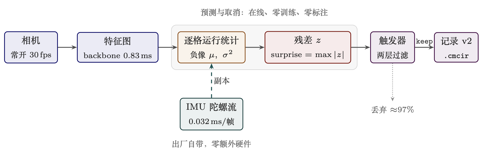
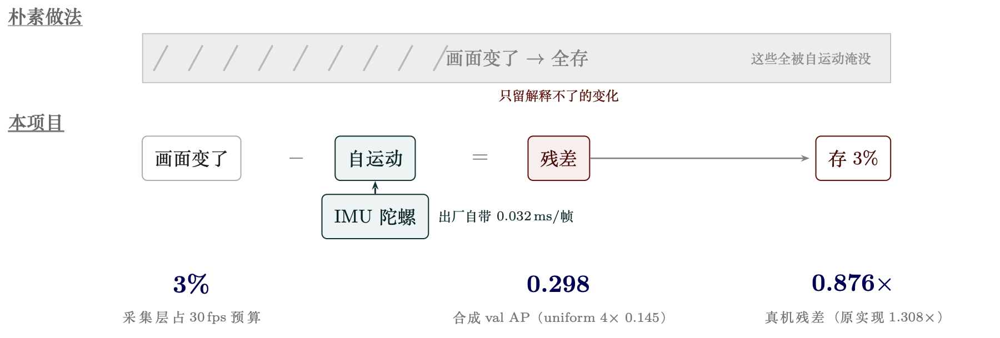

# Cerebellum-style residual-triggered data collection

[English](README.md) | [中文](README.zh.md)

A minimal prototype of the idea discussed from Perks et al. (Nature 2026,
doi:10.1038/s41586-026-10690-6): **a camera+IMU rig should not store what it
can predict**. The pipeline learns a "negative image" of the sensory
consequences of the rig's own motion (corollary discharge = IMU) and only
records the residual — the unexpected.



## The 3-minute version (read this if you are short on time)



**How to read it.** The top row is the **naive route**: treat "the picture
changed" as "something happened", so the rig's own walking, turning and hand
shake all count — the signal drowns in self-motion, and everything gets stored
(grey = that route does not work). The bottom row is **this project**: one extra
subtraction. Use the IMU gyro to learn per cell "how much change self-motion
usually causes", **subtract it**, and what remains — the residual — is the change
you cannot explain yourself. Only that gets stored (~3%).

**Why that subtraction is worth it.** Detecting "what matters" is hard (it needs
on-device semantic understanding); predicting **"which changes I caused myself"
is easy** — because the rig ships with its own motion sensor. So this runs with
**zero training, zero labels, ~0.2 ms/frame**, using an IMU consumer devices
already have. The structure is borrowed from neuroscience (corollary-discharge
cancellation in electric fish), but the advantage is purely engineering.

**Where the three numbers come from (and their scope).**
- **3%**: the acquisition layer costs ~1.0 ms/frame end to end (the IMU copy
  itself is only 0.032 ms) = 3% of a 30 fps budget. "Store only 3%" is the
  synthetic-rig reading; on the real desktop data the median is 9.2%.
- **0.298**: downstream val AP on the synthetic benchmark, beating uniform
  sampling at the same budget (uniform 4× budget = 51% storage, AP 0.145) and
  oracle (AP 0.191). **On real video this is not yet testable** — the
  verb-classification task scores the same at 8% and 100% storage (§2.3.6,
  corrected 2026-09-13), so it cannot rank selection quality. What *is*
  confirmed on real video is that the mechanism works and the filter selects
  as intended (§2.3.11).
- **0.876×**: on real-IMU segments the residual drops to 0.876× of baseline
  (the earlier tan-approximation translation was 1.308×, i.e. actively harmful).
  Absolute residuals are no longer bit-reproducible — **quote the ratio**, not
  the decimals.

**The half this figure does not draw, and it matters just as much.** The
residual **is not** semantic importance. Four independent experiment rounds
(downstream training value / inference-time gating / 24 target-signal
combinations / a labelled upper bound) approached from different directions and
**the boundary landed in the same place**: the residual answers "which pixel
motions can I not explain by self-motion" (**camera side**), while "what matters"
is a **world-side** semantic question. Using a camera-side motion quantity to
carry a world-side semantic label is a **category error** — negative by
construction, not because the estimator is weak, but because the question is
outside its domain.

> ⚠️ **Every ❌ in this document is a domain measurement, not a failure of the
> method.** Read the opening of [GUIDE.md §0.5](GUIDE.md) first, or those ❌
> will be misread as "it didn't work".

**What actually ships is two things.** ① An estimator whose **domain is measured
precisely** (applicable to motion dedup / bandwidth pre-screening, at two orders
of magnitude lower cost); ② a whole engineering delivery layer that **depends on
no single research claim** — a power-loss-safe record format, a trainable
multimodal dataset container, input-contract hardening, and an acquisition
integrity sentinel. The second is what you can use today.

---

## How to read the claims here (first, and it matters)

This README contains many sentences like "the residual does not carry event
information" or "the synthetic advantage does not transfer". **They read like
properties of an object, but all of them are readings taken under a protocol.**
We have **not** measured "what the residual is". What we measured is the tuple:

```
⟨ residual , specific label definition , sampling/budget protocol , criterion , data distribution ⟩ → a number
```

**Change any item in the tuple and the number may move**; a conclusion is only
responsible for **that one tuple**. For example:

| As written | What it actually is |
| --- | --- |
| "the residual does not carry event information" | under **frame-level binary, 1–8 s coarse intervals** it carries no information for the **training-value / gating** criteria |
| "the home-regime hypothesis does not hold" | on **those 10 segments**, **LOO×25 seed**, with **AP**, cerebellum ≈ uniform |
| "'more motion, more value' falsified" | on **those 4 segments (p95 71–75°/s)** the gyro warp loses to naive — not "at all motion scales" |

**This is not a disclaimer, it is a precision requirement.** Both of these hold:

1. **How wide the tuple is decides how strong the claim is**: some readings are
   strong ("cross-scene below chance" is hard to rescue at any label
   granularity), some are much weaker ("oracle is best" is +0.070 on 5 segments
   and only +0.036 on 10).
2. **But you also cannot dismiss a result as "protocol-dependent, so maybe a
   different protocol works"**: some protocol dimensions have been tried and
   closed (label granularity, target definition, signal choice, readout), and
   **the independent evidence lands in the same place** — at that point "the
   boundary is real" is justified. The key is to **list the dimensions that were
   tried**, not to mumble "unproven".

Every negative conclusion here should be able to answer "which tuple item could
change this, and has it been tried?". See GUIDE.md §2.0 for the details.

## The mapping

| Electric fish ELL (paper) | This prototype |
|---|---|
| Electric organ discharge (EOD) | Rig's own motion |
| Corollary discharge of EOD command | IMU gyro stream |
| Granule-cell temporal basis | Gyro features `[1, \|gx\|, \|gy\|, \|gz\|]` |
| Negative image (predictable response) | Per-cell linear prediction `w_fast + w_slow` + slow negative image `neg` |
| Associative depression/potentiation | Local anti-Hebbian updates, no backprop |
| Fast/slow plasticity pairing | `w_fast` (seconds) + `w_slow` (long), `w_fast` pulled toward `w_slow` |
| Equilibrium-rate plasticity gate | Per-cell gate: a cell that is *surprising right now* does not learn |
| Output cell residual | Per-cell z-scored residual; max over interior cells = surprise |
| Prey detection | Triggered clip saving (with hysteresis) |


## Current demo results (synthetic 60 s rig, 6 surprise events)

```
method                recall  precision   stored  clips
cerebellum            0.83    1.00        0.093    5
naive_diff            0.00    0.00        0.034    1
uniform(matched)      0.17    0.20        0.083    5
uniform(5%)           0.00    0.00        0.050    3
```

Naive frame-differencing drowns in self-motion (recall 0 even though the rig's
rotation is smooth); uniform sampling at the *same storage budget* as the
cerebellum method misses 5 of 6 events. One event is still missed by the
cerebellum pipeline (the earliest one, while statistics are still converging)
— see Limitations.

## Quick start

**In one sentence**: a camera + IMU acquisition layer — the gyro predicts "how
much *I* moved", that part is subtracted, and only what cannot be subtracted is
stored. Zero training, zero labels, ~0.2 ms/frame.

For the full project guide — method, cost accounting, every experiment including
the negative results, and the forward-looking deliverables — see
[`GUIDE.md`](GUIDE.md) (**it opens with a five-minute walkthrough**), also
available as a hyperlinked PDF with a bookmark outline: [`GUIDE.pdf`](GUIDE.pdf).
This README is the executive summary; the guide is the self-contained reference.

```bash
python3 -m venv .venv && .venv/bin/pip install -r requirements.txt
.venv/bin/python scripts/make_synthetic.py --seconds 60 --out data/synthetic
PYTHONPATH=. .venv/bin/python scripts/run_experiment.py data/synthetic
```

Run the unit tests:

```bash
PYTHONPATH=. .venv/bin/python -m pytest tests/
```

Run everything (tests + type check + doc-reference audit + manifest audit +
figure rebuild + guide PDF rebuild/verify) through one entry point:

```bash
make check          # fast-fail; use this before committing
make check-all      # run every step, then summarise
# equivalent without make:
PYTHONPATH=. .venv/bin/python scripts/check_all.py
```

Figures are TikZ (`figs/*.tikz`) built into **both** a vector PDF (embedded in
`GUIDE.pdf`) and a PNG (shown here on GitHub) by one command:

```bash
.venv/bin/python scripts/build_figures.py   # figs/*.tikz → figs/*.pdf + figs/*.png
```

The frame size is **measured**, not declared: the script typesets each figure
on A4 once, reads the true box dimensions, then re-typesets on exactly that
paper size. Hand-declaring a size means guessing, and guessing too small
silently crops the figure. `make check` runs this before rebuilding the PDF,
and `scripts/verify_guide_pdf.py` asserts the embedded figures are **vector**
(Form XObjects) rather than bitmaps.

This gate is deliberately strict about two things: the pre-existing 6 errors in
`tests/test_extract_featmaps_dino.py` are recorded as an **expected baseline**
(so they can neither hide new failures nor grow), and the shipped package
(`cerebellum_cancel/`, `tests/`) must keep **0 type errors** while one-off
probe scripts under `scripts/` are only required not to regress. It has already
caught two real problems on its first runs: four documents referencing a
`scripts/eval_weight_value.py` that did not exist, and 4 pre-existing pyright
errors in `scripts/` that no earlier check had looked at.

A self-contained subset of this repository (package + minimal scripts +
tests, no datasets) is packaged in `public_edition/`. It ships the **online
acquisition layer**: cancellation (`core`, `featmap_cancel`, `rotwarp`),
the pluggable `acquisition` API, the `pipeline`, and the input `contracts`.
The offline dataset layer (`integrity`, `dataset`) is deliberately omitted —
none of the claims above depend on it, and its contract tests are omitted
with it. Its `scripts/demo_video.py` renders a side-by-side demo video (raw
frame | residual heatmap | HUD) from any sequence — the same script also
exists at `scripts/demo_video.py`:

```bash
cd public_edition && pip install -r requirements.txt
PYTHONPATH=. python scripts/make_synthetic.py --out demo_scene
PYTHONPATH=. python scripts/run_experiment.py demo_scene   # cerebellum recall 1.00 vs uniform 0.17
PYTHONPATH=. python scripts/demo_video.py --src demo_scene --out demo_video.mp4
```

`make check` also guards this subset: its shared files must stay
**byte-identical** to the main tree and its tests must pass in isolation. That
check exists because the subset once silently fell months behind (6 missing
modules, 4 drifted shared files) while its own tests still passed — staleness
with no signal. To be explicit about the trade-off: the subset is a **copy, not
a branch**, so any fix must land in the main tree first and then be synced;
editing `public_edition/` directly will be flagged as drift.

## Real capture with an iPhone

1. **Video**: record with the Camera app (1080p30 is plenty).
2. **IMU**: run *Sensor Logger* (or any app exporting CSV) with gyroscope at
   ≥100 Hz. Expected columns: `time,gyroscope.x,gyroscope.y,gyroscope.z`.
3. **Sync**: before the scene starts, shake the phone sharply once. The spike
   is visible in both the video and the gyro norm; compute
   `imu_offset = t_shake_video - t_shake_imu` and pass `--imu-offset`.
4. **Ground truth**: annotate `events.json`:
   `{"events": [[t0, t1], ...], "fps": 30}` with the timestamps of anything
   that should have been recorded.
5. Run: `PYTHONPATH=. .venv/bin/python scripts/run_experiment.py data/my_rec`

## First real capture (webcam, desk scene)

One 65 s desk recording with an external webcam (30 fps) + phone gyro stream
(synced by the shake trick, `imu_offset` 11.342 s), 6 annotated events:

```
method                recall  precision   stored  clips
cerebellum            0.33    0.50        0.102    4
naive_diff            0.00    0.00        0.042    2
uniform(matched)      0.17    0.17        0.092    6
uniform(5%)           0.17    0.33        0.046    3
```

The relative ordering survives on real data (cerebellum > baselines at matched
budget), but absolute recall drops from 0.83 to 0.33: the two late events are
caught, the four earlier ones are missed, and one early clip (5.5–8.9 s) is a
false trigger. A 60 s desk scene is exactly the regime the README's
limitations predict to be hard — autofocus breathing, exposure adaptation,
small background motion — all of which read as "surprise" until the negative
image absorbs them. This recording predates the multi-timescale tuning and
still uses the hand-set thresholds; treat it as a sanity check (real sensor
noise does not break the pipeline) rather than a performance measurement.

Reproduce:

```bash
PYTHONPATH=. .venv/bin/python scripts/run_experiment.py data/webcam_rec
```

## Adapter experiment: cerebellum as a frozen-backbone add-on

Extends the mapping from the signal level to **modern CV stacks**: freeze an
ImageNet-pretrained MobileNetV3-small (576-d pooled features), insert a
cerebellum adapter behind it, and ask whether the adapter's residual helps a
downstream event head.

Adapter (`cerebellum_cancel/adapter.py`): fixed random granule expansion
`phi([f_{t-1}, a_t])` -> linear predictor `W_slow` (ridge on train set) +
`W_fast` (online, unit-norm-gated anti-Hebbian, decays toward zero); frames
that are currently surprising do not update anything (equilibrium-rate gate);
output = z-scored residual `r_t = (f_t - f_hat_t) / sd`.

Benchmark (`data/dataset`): 50 synthetic sequences, textured scene + smooth
self-rotation + IMU; train at motion scale 1x, val at 3x (a regime shift).
Event = an object appearing/moving. Slow predictor reaches R^2 = 0.971.

```
variant            AP@1    AP@4   AP@16   AP@40   evRec@10%
A_static          0.536   0.871   0.842   0.815        1.00   (head on raw features)
B_slow_only       0.223   0.185   0.157   0.162        1.00   (head on residual, W_slow)
C_cerebellum      0.193   0.179   0.171   0.186        1.00   (head on residual, W_slow+W_fast)
C_energy             --      --      --   0.325        0.76   (untrained sum(z^2) readout)
```

**Honest negative result.** On this benchmark the adapter does not beat raw
frozen features, in any configuration (trained/few-shot/untrained readout).
Reasons, in order of how fundamental they are:

1. **Pooled deep features are already motion-robust.** A 1-4s motion regime
   shift does not hurt A at all — the trained head finds blob-sensitive dims
   and motion variation is learnable background. Cancellation has nothing to
   remove that the head cannot already ignore.
2. **Residual noise is not learnable-away.** Raw features = signal + stable
   background (a trained head subtracts the background for free); residual =
   signal + motion-prediction noise (a linear map on *pooled* features cannot
   express "content shifted by k px", so ego-motion leaks into the residual).
   Unless the predictor is near-perfect, cancellation trades removable
   background for unremovable noise — here that trade loses.
3. **The event is too salient.** A white blob on textured background is
   trivially separable in feature space; the ELL's advantage (surprise pops
   out of a cancelled background) needs events that are subtle relative to
   the predictable structure.

What *did* hold up: B/C AP is unchanged across the 1x->3x motion regime
shift (0.15-0.19 both regimes) while being trained only at 1x — the residual
is genuinely motion-invariant, and W_fast now learns stably (an initial
LMS-divergence bug: `fast_lr=0.02` vs stability bound `2/||phi||^2 ~ 0.016`,
fixed by unit-normalizing granule outputs). The strong version of the
mechanism remains the pixel-space one (Current demo results above), and its
feature-space form is the geometric variant in the next section.
*(Measured on the salient-event dataset; the current default dataset is the
open-set variant used below.)*

Reproduce:

```bash
PYTHONPATH=. .venv/bin/python scripts/make_dataset.py --n-train 40 --n-val 10 --seconds 20
PYTHONPATH=. .venv/bin/python scripts/extract_features.py data/dataset   # needs torch+torchvision
PYTHONPATH=. .venv/bin/python scripts/train_adapter.py data/dataset
```

## Feature-map cancellation (geometric, untrained)

The pooled-feature adapter above loses because a linear map on *pooled*
features cannot express "content shifted by k px" — ego-motion leaks into the
residual as unlearnable noise. This module is the spatially structured fix,
and the closer analogue of the ELL negative image:

- backbone feature maps `F_t` (MobileNetV3-small `features[:3]`, 24x28x28,
  frozen, spatial structure kept);
- **predict** `F_hat_t(x) = F_{t-1}(x - dx_t)` where `dx_t` comes from the
  IMU gyro (corollary discharge) converted to map pixels —
  `dx = f_map * tan(radians(gyro) / fps)` (sign verified empirically);
- **residual** `r_t = F_t - F_hat_t`, z-scored by per-cell running statistics
  that update on calm frames only (equilibrium-rate gate; warmup frames
  bootstrap the stats unconditionally);
- **readout**: untrained — pooled z-energy, or strongest interior cell.
  Nothing anywhere is trained.

Benchmark: same 50 sequences but now the open-set version — train events are
faint blobs (alpha 0.3), val events at 3x motion are **faint bars in a
different screen region: a shape no trained head has ever seen**.

```
                          val AP   evRec@10%      (25 val sequences)
gyro_warp + maxcell        0.304       0.64   (untrained — best overall)
gyro_warp + energy         0.209       0.49   (untrained)
C cerebellum (pooled)      0.182       0.91   (trained on residual)
B slow-only  (pooled)      0.165       0.91
naive_diff + maxcell       0.171       0.51   (untrained, no warp)
naive_diff + energy        0.172       0.34
A static head (pooled)     0.119       0.64   (trained on raw features — collapsed)
```

Three claims, in increasing strength:

1. **The gyro warp works.** Calm-frame residual drops 2.6x (0.48 -> 0.18)
   and every gyro_warp readout beats its naive_diff twin at 3x motion.
2. **Surprise representations transfer; appearance representations do not.**
   A's head trained on raw features collapses on unseen event types (recall
   0.46); heads trained on *residuals* hold 0.8-0.9 recall — they learned the
   noise model, not the event.
3. **A fixed, untrained front-end wins the open-set regime outright.**
   gyro_warp + maxcell (0.271 AP) beats every trained-head variant, with zero
   training and zero event-type assumptions — the architecture固化:
   alignment, local gating, and a trivial readout are all the machinery.

Caveats: absolute APs are modest (faint bars under 3x motion are hard for
everything); the open-set margin held when val was expanded 10 -> 25
sequences (gyro_warp+maxcell 0.271 -> 0.304 AP, ordering unchanged);
"untrained" still assumes the gyro-to-shift calibration (f_map) is known.

Reproduce:

```bash
PYTHONPATH=. .venv/bin/python scripts/make_dataset.py --n-train 40 --n-val 25 \
    --seconds 20 --event-alpha 0.3 --val-event-shape bar
PYTHONPATH=. .venv/bin/python scripts/extract_featmaps.py data/dataset
PYTHONPATH=. .venv/bin/python scripts/run_featmap_eval.py data/dataset
```

## Downstream training comparison (the headline claim, measured)

Does a rig that stores only cerebellum-triggered clips train a downstream
model **better per stored byte** than uniform sampling? Training frames are
sampled from the 40 train sequences by each method at matched storage
budgets; the downstream model is the same LogisticHead on frozen MobileNetV3
features as in the adapter experiment; eval is on the full 25-sequence val
split (frame-level AP, event recall at a top-10% budget). Clip source is the
feature-map cancellation front-end above (gyro warp + maxcell z^2 readout) —
the pixel-space trigger was measured to never fire on this dataset (train
events are faint, alpha 0.3; its z < 6 persistence gate needs salient
events: recall 0.13 even at threshold 2.5).

Triggering is **self-calibrating** (`AdaptiveTrigger`): the raw z^2 score is
normalized by its own calm-frame running statistics before the dimensionless
6/2.5 hysteresis gate, so no hand-set score threshold is needed. The
previous hand-set operating point (T=300) is kept as a reference row.

```
method                stored  frames   val AP   evRec@10%
cerebellum (adaptive)  0.034     826    0.298       0.96
uniform(0.5x)          0.061    1457    0.135       0.58
uniform(1x)            0.074    1766    0.131       0.59
uniform(2x)            0.091    2181    0.125       0.58
uniform(4x)            0.121    2894    0.120       0.57
oracle(adaptive)       0.019     449    0.191       0.72
--
cerebellum(T=300)      0.150    3593    0.210       0.92   (hand-set reference)
```

Claims, strongest last:

1. **Cerebellum clips beat uniform at 4x the bytes.** At 3.4% stored (826
   frames), AP 0.298 / evRec 0.96; uniform needs 3.5x the frames (12%) and
   still loses by a wide margin (0.120 / 0.57).
2. **The win is the data, not the budget.** Scaling uniform's budget up does
   not close the gap (it gets worse past 0.5x — more dilute background), so
   the advantage is event enrichment, not storage volume.
3. **Cerebellum clips even beat the oracle** (budget spent only on
   ground-truth event frames) on both metrics (0.96 vs 0.72 evRec). The
   trigger keeps event onsets, disappearances, and motion-boundary context —
   exactly the frames a discriminative head needs — where oracle keeps only
   mid-event frames.
4. **Self-calibration beats the hand-set threshold.** The adaptive trigger
   stores 4.3x fewer frames than the T=300 operating point AND trains a
   better head (0.298 vs 0.210 AP) — normalizing by the trace's own calm
   statistics is a sharper criterion than any fixed raw threshold.

Regime check (val split, 3x motion, mean stored fraction): adaptive 0.339
vs T300 0.379. Both inflate under the regime shift — the calm gate refuses
to absorb motion bursts into the baseline (by design), so a 3x noisier rig
still stores proportionally more. Self-calibration buys precision at the
operating regime, not regime invariance; the slow-timescale absorption of a
persistent new motion level would need longer streams than 20 s.

Head robustness (same clips, stronger downstream model): swapping the
LogisticHead for a 128-hidden MLP does **not** raise val AP — it lowers it
(cerebellum adaptive: 0.298 -> 0.200; a 5-config regularization sweep —
hidden/l2/dropout/iters — tops out at 0.247). The val regime (3x motion +
unseen bar shape) punishes capacity: the MLP overfits motion-specific
correlations in the training clips, the same failure the adapter section
documented for appearance-based heads ("surprise representations transfer;
appearance representations do not"). What the MLP does improve is the top of
the ranking (evRec@10% 0.96 -> 0.99-1.00 on cerebellum clips). The
data-value claim is unchanged across every head and config: cerebellum
clips beat uniform at all matched budgets, and beat the oracle on event
recall. On this benchmark, AP is data-limited, not model-limited.

Caveats: byte budget is proxied by frame count (bitrate per frame is similar
across methods by construction); the frozen feature extractor is assumed to
ship with the rig (the adapter section's premise); 6/2.5 are still chosen
constants, just dimensionless ones; and the downstream head is deliberately
small — the claim is about *data value per byte*, not peak detector
performance (a stronger MLP head is measured below: it does not raise AP).

Reproduce:

```bash
PYTHONPATH=. .venv/bin/python scripts/train_downstream.py data/dataset
```

## Optical-flow baseline and cost profile

The CV-native alternative to the gyro warp is dense optical flow: compensate
with what the image content itself says, no IMU needed. Measured end-to-end
on this benchmark (`cerebellum_cancel/flow_cancel.py`, DIS preset MEDIUM;
15 train + 5 val sequences):

```
                    calm residual (mean |err|)     stored   evRec
                    train (1x)   val (3x)          val(3x)  val(3x)
naive (no warp)        0.093        0.221            --       --
gyro warp              0.079        0.129           0.113    0.30
DIS flow warp          0.070        0.103           0.192    0.33
```

**Stronger flow estimators do not beat DIS here.** RAFT (Teed & Deng,
ECCV 2020, raft-things weights) was plugged into the same warp path
(`scripts/run_raft_eval.py`), answering "is the flow ceiling just an
artifact of DIS being weak?":

```
                    calm residual (mean |err|)      ms/frame
                    synthetic val   real high-motion (224px, robust)
naive                  0.221             0.080                --
gyro warp              0.129             0.090              0.033
DIS flow warp          0.106             0.052          5.9 / 7.4
RAFT flow warp         0.105             0.054        134 / 138
```

(5 synthetic val sequences; 2 real high-motion sequences.) RAFT ties DIS
on synthetic (0.1054 vs 0.1056) and is marginally worse on real (0.0544
vs 0.0522) while being ~20x slower. The flow ceiling is an
estimator-independent property of the task, and the gyro-vs-flow residual
gap cannot be closed by swapping in a learned flow model.

```bash
PYTHONPATH=. .venv/bin/python scripts/run_raft_eval.py data/dataset --split val --n-seq 5
PYTHONPATH=. .venv/bin/python scripts/run_raft_eval.py data/aoe_motion --split val --n-seq 2 --robust
```

Median per-frame latency on this machine (320x240 frames, 24x28x28 maps):

```
stage                     ms/frame
gyro shift (24x28x28)      0.032
pixel pipeline core        0.171   (warp + cells + plasticity + trigger)
frozen backbone fwd        0.827   (MobileNetV3 features[:3], 224x2, MPS)
DIS flow (320x240)         3.813
full flow-cancel step      4.456
```

Takeaways:

1. **Flow does buy residual quality** — 11% lower calm residual than the
   gyro warp at 1x, 20% at 3x (DIS tracks the actual content displacement,
   including what the gyro approximation misses). This is real, and the
   largest honest advantage of the flow baseline.
2. **It costs 26x the entire pixel pipeline** (4.5 ms vs 0.17 ms per frame,
   ~120x at the warp step alone) — on a 30 fps budget the pixel pipeline
   uses 0.5% of the frame time, the flow step 13%. And these timings are on
   a laptop; on-device (phone CPU, no MPS) DIS is typically several times
   slower still.
3. **It needs texture and stability**: DIS loses the target under fast
   motion (one 3x val sequence stores 59% of the stream vs gyro's 13% —
   flow noise reads as surprise) and has no answer for textureless or
   low-light patches, where the gyro warp is unaffected. Event regions
   corrupt the local flow field, leaking into the residual.
4. **Architecture reading**: the gyro warp is a ~30 µs matrix op that
   turns the IMU into a corollary discharge; flow is a per-frame computer
   vision computation that must run before the compensation it feeds. For
   a rig whose whole point is *cheap always-on* surprisingness, the IMU is
   the right layer — flow is the quality ceiling to compare against (now
   confirmed estimator-independent with RAFT), and
   the residual-quality gap (11-20%) is the honest price of the 100x
   cost ratio. A sub-pixel gyro shift and a better f_map calibration would
   close part of that gap.

**Cross-platform portability** (`scripts/run_portable_check.py`,
`runs/portable_check.json`): the only device-dependent stage is the frozen
backbone forward. On the same frames, CPU vs MPS features agree to a max
relative diff of 2e-6 and the downstream gyro calm residual differs by
3.7e-9 — the cancellation path is numerically device-portable. Latency:
backbone 1.76 ms on CPU vs 1.06 ms on MPS (1.7x), so the pipeline stays
well under one 30 fps frame budget on CPU. The remaining unmeasured
boundary is phone-class hardware (no laptop MPS, slower cores).

Reproduce:

```bash
PYTHONPATH=. .venv/bin/python scripts/run_flow_eval.py data/dataset
```

## Resolution: the knob that decides whether the gyro warp pays

The gyro warp can only remove motion the feature map can *see*. The same
rotation produces a content shift of `f_map * tan(omega/fps)` map px, and
`f_map` scales with backbone input size. Re-running the benchmark at three
input sizes (same 40 train + 25 val sequences, MobileNetV3 features[:3],
stride 8; `f_map` 24.25 at 224 px is the rig default) isolates resolution
as the variable:

```
input   map      f_map   calm residual (val)   gyro gain   gyro shift   DIS flow
        size           naive   gyro   flow    vs naive    ms/frame     ms/frame
224     28x28    24.25   0.221   0.130  0.107   -41%        0.032        3.86
336     42x42    36.38   0.187   0.089  0.069   -52%        0.061        4.20
448     56x56    48.50   0.169   0.072  0.052   -58%        0.087        4.35
```

(backbone forward is ~0.6 ms/frame at every size on MPS — shallow stride-8
layers are memory-bound; the protocol cost of resolution is in storage and
bandwidth, not compute. Same-session re-measurement, `runs/flow_eval_res*.json`.)

The gain is monotone and has not saturated: every 1.5x input size removes
another ~6-10 points of calm residual that the naive predictor cannot
touch. The flow gap narrows with resolution too (flow/gyro 0.82 -> 0.73):
the gyro warp's main error source — sub-pixel quantization of the shift —
shrinks as the map gets finer. This also retroactively explains both real
regimes: desk-egocentric Open-AoE at 224 px is f_map ~11-19 with rotation
under ~5 deg/s (shift < 0.05 map px — nothing to remove, warp neutral),
while the high-motion pair at p95 |yaw| 31-52 deg/s reaches ~0.5-0.7 map
px — inside the window where model error (uncompensated roll, calibration)
starts to *add* residual instead of removing it.

Design rule for the protocol layer: **corollary-discharge cancellation is
a resolution-gated primitive** — pair it with fine-grained features
(DINOv2 patch tokens, or stride-8 maps at >= 448 px input) and it removes
half the predictable residual for ~0.09 ms/frame; at coarse maps it is
free but neutral. (Update 2026-09-09: the DINOv2 patch-token half of this
pairing has since been measured and closed — ViT patch tokens fire 3/40
segments at best vs MNV3's 11/40 at the residual-trigger operating point;
see "Backbone replacement route closed" below. The rule stands for
stride-8 conv maps, where it was measured.) The same variable decides whether the *trigger* keeps
working: at 448 px the gated self-normalizing trigger froze to zero clips
on all 5 synthetic val sequences (baseline surprise grows and
heavy-tails with resolution), while winsorized robust stats fired on all
5 — the real-video gate failure, reproduced on synthetic data.

Reproduce:

```bash
# featmaps at other input sizes; f_map scales linearly (24.25 * size/224)
for S in 336 448; do
  .venv/bin/python scripts/extract_featmaps.py data/dataset_$S --size $S
  PYTHONPATH=. .venv/bin/python scripts/run_flow_eval.py data/dataset_$S \
      --n-train 40 --n-val 25 --size $S
done
```
(The `data/dataset_$S` dirs hold symlinks to the frames, `imu.csv` copies
and `events.json` with the scaled `f_map`; delete/rebuild at will — the
featmaps re-extract in minutes.)

## Flow-as-arbiter cascade

A middle architecture between "gyro only" and "flow every frame": the gyro
warp runs always-on; DIS flow is consulted **only on trigger candidates**, as
an arbiter that vetoes the ones it can explain. Composition per candidate
peak frame (`scripts/run_arbiter_eval.py`): the gyro shift pre-warps both the
gray pair (so DIS only searches the small residual the gyro model
mispredicts — without this, DIS loses track at large rotations, exactly where
triggers fire) and F_{t-1}; DIS then refines along the residual flow. A
candidate run is vetoed when the flow-refined residual keeps < `explain_ratio`
(0.5) of the gyro residual's interior energy — i.e. the residual was
ego-motion misprediction, not surprise.

Measured on the full benchmark (15 train + 5 val, run-level readout —
fixed-threshold runs, which unlike `AdaptiveTrigger`'s adaptive clips are
monotone in the trace):

```
                 stored   precision   evRec   DIS calls/seq   amortized ms/frame
train gyro        0.401      0.257      1.00        --               --
train cascade     0.401      0.257      1.00       21.3            0.135
val   gyro        0.520      0.146      1.00        --               --
val   cascade     0.498      0.155      1.00       23.6            0.150
```

Honest read: on this synthetic rig the cascade is almost a no-op (6 of 118
val runs vetoed). That is a *measured* property of the benchmark, not a
weakness of the arbiter — three mechanisms explain it, each verified:

1. The synthetic rig is pure global yaw/pitch translation (roll < 1 deg/s),
   which is exactly the model class of the gyro warp, so the warp is
   near-exact and calm-frame residuals are feature noise, not modeling error
   (flow-refined residual energy ≈ gyro residual energy, ratio 1.03–1.27).
2. At 28x28 maps, subpixel miscalibration stays under the feature-noise
   floor: stressing f_map by 10–50% still leaves `rho ≈ 1`, so no veto fires
   (`--fmap-scale` in the eval script).
3. What the arbiter *would* catch — structured residuals the global-shift
   model cannot express (real roll, parallax/depth, large calibration
   error) — does not exist in this data.

So the cascade's status is: mechanism and cost validated (~0.15 ms/frame
amortized, ~25x cheaper than running DIS every frame, veto power retained
when it matters), value pending real-camera validation — it is the right
safety net for exactly the failure modes the synthetic rig lacks. The
run-level readout also exposed that `AdaptiveTrigger`'s running normalization
is non-monotone (zeroing a vetoed run can *re-sensitize* later clips), which
the cascade evaluation sidesteps by comparing at fixed-threshold run level.

```bash
PYTHONPATH=. .venv/bin/python scripts/run_arbiter_eval.py data/dataset
```

## Real egocentric validation (Open-AoE)

The synthetic rig is pure global yaw/pitch, so a first real-world check
uses [Open-AoE](https://github.com/ant-research/Open-AoE) (inclusionAI/
OpenAoE-2000h on HF): ~700h of consumer-phone egocentric video with a
visual-SLAM camera trajectory and time-aligned atomic-action labels. Nine
diverse segments (bathroom / bedroom / childs-room / dining / kitchen /
living-room / workshop / workspace / shop, 134–301 s each, 67.4k frames
total) were selected from a 60-segment probe by `scripts/fetch_aoe.py`
(greedy scene/verb coverage, duration and head-motion filters) and
prepared by `scripts/prep_aoe.py`, which differentiates `cam_c2w` into
the gyro-like signal the pipeline expects (per-axis signs
auto-calibrated against DIS flow; |r| = 0.18–0.93, worst on two
near-static clips where there is no motion to correlate) and writes the
standard sequence layout, with each phone's real focal length
(`f_map` = 10.95–19.17, fx 751–1315, not the synthetic rig's 24.25).

Measured first on one segment (seq_000), then generalized across all nine —
three findings that the synthetic rig could not produce:

1. **Real ego-motion is sub-pixel at 28x28.** Median content shift is
   0.013 map px (p95 0.05, max 0.16), so the gyro warp is physically
   neutral here: calm residual naive 0.0323 vs gyro 0.0328. The
   corollary-discharge warp only earns its keep at finer resolution,
   deeper features, or walking-scale motion — not at a desk-egocentric
   clip at 224 px input.
2. **The equilibrium-rate gate freezes on real data.** 96.4% of frames
   have surprise > 4, so after warmup the running stats update on only
   3.6% of frames and the sd ratchets down (0.92 -> 0.17); z saturates
   (median max|z| = 13) and the two readouts degenerate in opposite
   directions: fixed-threshold runs cover 92% of all frames, while
   `AdaptiveTrigger`'s relative normalization fires **zero** clips. The
   calm-gate assumption (surprise is sparse) holds for pop-in synthetic
   events and fails for real video. The fix is winsorized always-update
   stats (`CancelConfig.robust`): outliers enter the running stats
   clipped at 3 sigma, so they can neither inflate the scale nor freeze
   it through the gate. With robust stats the trigger fires again on
   this segment: **9.9% stored at 0.79 event recall (zero clips
   before)**. Telling cross-check: the DIS flow baseline
   (`FlowWarpCancel`) shares the same gated stats and also fires zero
   clips on real video — the gate, not the predictor, was the failure.
3. **Residual spikes are real but misaligned with action labels.** The
   top residual frames are fast hand/object motion with motion blur
   (`runs/aoe_peaks/`), yet the score is *anti*-correlated with the
   annotation's action intervals (AUC 0.47): atomic actions are extended
   intervals with varying motion energy, while the residual indexes
   motion transients. Frame-level event-recall against human action
   labels is therefore the wrong metric on real data; for the
   residual-triggered *storage-selection* architecture the meaningful
   metric is downstream value of the selected clips (as in the
   downstream section above), not label alignment.

Across all nine segments the three findings hold: gyro-warp calm residual
never beats naive by more than noise (sub-pixel ego-motion everywhere,
median content shift < 0.05 map px); the robust-stats trigger fires on
every clip (stored 1.2–13.1%, median 9.2%, event recall 0.14–0.79, median
0.46 vs action labels — the seq_000 spread, now with error bars); and the
DIS flow baseline still mostly fires zero clips under the same gated
stats, except where flow itself hallucinates triggers (seq_004: 99%
stored). Per-sequence numbers: `runs/flow_eval.json`.

At the runs level the arbiter generalizes too (`runs/arbiter_eval.json`):
across the nine clips, 140 candidate runs/seq under robust stats, the
cascade vetoes 8–31% of them (flow calls amortize to 0.89 ms/frame),
cutting storage 0.89 -> 0.72 of flagged frames at precision 0.994 with
event recall 1.00 -> 0.94; at the clip level, AdaptiveTrigger stored
7.9% -> 20.6% with recall 0.49 -> 0.55 — the vetoed runs were dominated
by ego-motion modeling error even at sub-pixel shifts.

**The high-motion end** (2 segments at the top of the 259-probed pool,
p95 |yaw| 31–52 deg/s vs 1–41 on the desk clips; `data/aoe_motion`,
`runs/flow_eval_motion.json`) finally leaves the sub-pixel regime — and
the ranking of predictors flips, with caveats. Calm residual: gyro warp
is now *worse* than naive (0.090 vs 0.080; the 2D-shift model leaves
roll uncompensated and the sign-calibration is weaker there, y r = 0.15
on the warehouse clip), while DIS flow clearly wins on quality (0.052) —
and loses on cost by ~250x (8.4 ms vs 0.033 ms per frame). The robust
trigger also thins out (stored 1.4%/1.2%, evRec 0.09/0.04): continuous
real motion makes the residual heavy-tailed, the winsorized sd inflates,
and the z-bar rises. The arbiter is exactly the bridge for this regime:
it vetoes 11% of runs on the liveliest clip (stored 0.92 -> 0.62 at
precision 1.00, amortized 0.58 ms/frame). Honest bottom line: on this
corpus even the top-decile rotation stays ~0.5 map px/frame at 28x28, so
the gyro warp's quality window is narrow at this resolution — its case
is cost, and the flow arbiter is the paid upgrade when the cheap model
breaks. (n=2; the axis-calibration caveat above applies.)

**Resolution cross-check at 448 px** (same pair, feature map doubled,
38x38; `data/aoe_motion_448`, `runs/flow_eval_motion448.json`): the
design rule "finer features turn the gyro warp positive" — which holds
monotonically on synthetic (gyro gain -41/-52/-58% at 224/336/448) —
does **not** transfer to real high-motion. Gyro is still worse than naive
(0.0535 -> 0.0614, +15%), and DIS flow flips per sequence (0.086 on the
hallway clip, 0.051 on the warehouse clip; mean 0.068, worse than naive
on one of two). On real data the damage is dominated by what the
rotation-only model cannot see — translation/parallax and rolling-shutter
distortion — and more pixels make that *more* visible, not less.
Resolution fixes estimator error; it cannot fix model-class error. The
next model gap to close is translation, not resolution — and closing it
turned out to be harder than it looks:

**Translation term: measured, negative** (`scripts/run_trans_eval.py`,
`runs/trans_eval_data_aoe_motion_val.json`). The SLAM trajectory also
yields camera-frame translation velocity, and prep_aoe.py calibrates a
per-segment constant-depth scale (1/Z, least squares against DIS flow —
same calibration status as the gyro sign flips and f_map). On the
high-motion pair the rotation+translation warp is *worse* than
rotation-only (calm residual 0.0901 -> 0.0938, both sequences). A uniform
translation shift explains the mean flow but misaligns per-cell: real
scenes are depth-structured (near walls + far end of a hallway move
differently), so the constant-depth model class is wrong, and no
per-segment scalar calibration can fix that. Translation compensation
needs depth structure (monocular depth, plane models) or stays with the
on-demand flow arbiter.

```bash
# re-prep writes translation columns + the per-segment trans_scale
PYTHONPATH=. .venv/bin/python scripts/prep_aoe.py data/aoe_src/<segment> \
    --out data/aoe_motion/val/seq_XXX
PYTHONPATH=. .venv/bin/python scripts/run_trans_eval.py data/aoe_motion \
    --split val --n-seq 2
```

```bash
# pick + download segments (probe -> select -> fetch, each cached)
.venv/bin/python scripts/fetch_aoe.py probe --n 60
.venv/bin/python scripts/fetch_aoe.py select --k 8
# high-motion regime: filter by trajectory-derived rotation before selecting
.venv/bin/python scripts/fetch_aoe.py select --k 3 --motion-min 60
.venv/bin/python scripts/fetch_aoe.py fetch
# convert to the standard sequence layout, one dir per segment
for d in data/aoe_src/<segment>; do
  PYTHONPATH=. .venv/bin/python scripts/prep_aoe.py "$d" --out data/aoe/val/seq_XXX
done
PYTHONPATH=. .venv/bin/python scripts/extract_featmaps.py data/aoe
PYTHONPATH=. .venv/bin/python scripts/run_flow_eval.py data/aoe --n-train 0 --n-val 9 --robust
PYTHONPATH=. .venv/bin/python scripts/run_arbiter_eval.py data/aoe --n-train 0 --n-val 9 --robust
```

## Real-data downstream value (negative result)

The synthetic headline (cerebellum clips train better per stored byte)
does **not** transfer to real egocentric video — measured, with caveats.

A task-level change was forced by the data: the "active manipulation"
annotation covers ~100% of frames in 8 of 9 segments, so the binary
event-detection task degenerates. The real-data task is frame-level verb
classification over 7 target verbs from the atomic-action annotations
(fold, grasp, insert, set_down, thread, unfold, wipe — each >= 300
annotated frames in both split halves; `scripts/make_verb_labels.py`),
one-vs-rest logistic heads on frozen 576-d pooled features, 6 segments
train / 3 val (`scripts/train_downstream_aoe.py`,
`runs/downstream_aoe_results.json`):

```
method          stored  frames  val mAP  ivRec@10%
cerebellum       0.071    3296    0.197     0.75
uniform(0.5x)    0.035    1643    0.209     0.68
uniform(1x)      0.071    3317    0.192     0.75
uniform(2x)      0.143    6696    0.204     0.77
uniform(4x)      0.290   13516    0.193     0.73
oracle           0.056    2528    0.203     0.80
```

The trigger works (stored 7.1%, interval recall 0.75) but the selected
frames are not the discriminative ones: residual triggering stores what
is *kinetically* unpredictable (motion bursts), while verb identity is
semantic and spread over the whole manipulation interval — consistent
with the measured frame-level anticorrelation of residual peaks vs
action annotations (AUC 0.47, §above). The mAP spread (0.19-0.21) is
noise-scale; single split, no seed error bars — the 3-fold CV rerun in
the next section supersedes this table. The scope conclusion offered at
the time ("the value proposition holds in the sparse-physical-event
regime it was designed for") was the one remaining escape hatch; it was
tested head-on below, and falsified.

```bash
PYTHONPATH=. .venv/bin/python scripts/extract_features_aoe.py data/aoe
PYTHONPATH=. .venv/bin/python scripts/make_verb_labels.py data/aoe
PYTHONPATH=. .venv/bin/python scripts/train_downstream_aoe.py data/aoe
```

## Real-data downstream value, CV rerun (negative result confirmed)

The single-split table above is superseded by a cross-segment rerun:
12 segments (3 added), 9 verb classes (fold/grasp/hold/insert/lift/
set_down/thread/unfold/wipe, each >= 300 annotated frames in both split
halves), 3-fold cross-segment CV × 35 seeds = **105 rounds/method**,
robust trigger (`scripts/run_downstream_aoe_cv.py`,
`runs/downstream_aoe_cv.json`):

```
method          stored  val mAP        ivRec@10%
cerebellum       0.160  0.161±0.078    0.67±0.12
uniform(0.5x)    0.081  0.176±0.089    0.72±0.08
uniform(1x)      0.161  0.173±0.081    0.68±0.07
uniform(2x)      0.240  0.174±0.089    0.71±0.06
uniform(4x)      0.400  0.169±0.082    0.71±0.09
oracle           0.132  0.164±0.089    0.72±0.09
all(100%)        1.000  0.166±0.083    0.71±0.08
```

The earlier 0.197 was single-split sampling noise. **But the last row
retracts the original reading of this table**: storing 100% of frames
scores the same as storing 8% — **12× more data buys nothing**, so this
task cannot measure selection quality at all. The 1σ overlap is evidence
about a broken yardstick, not about the trigger. (§2.3.6, corrected
2026-09-13; the oracle here was also degenerate — 48–100% of frames carry
a verb label, so "pick by ground truth" collapsed into "pick at random".)

**What *is* supported on real video** (§2.3.11): the compensation
mechanism works (shuffling or sign-flipping the gyro turns a +0.045 gain
into −0.063/−0.065 — 10/11 segments become 1/11) and the filter selects as
intended (84% of frames dropped, downstream still finds actions in 67% of
intervals). Residuals give you *physically surprising* frames, not
*semantically important* ones.

```bash
PYTHONPATH=. .venv/bin/python scripts/run_downstream_aoe_cv.py data/aoe
```

## Sparse physical-event regime: home-field test (negative result)

The scope conclusion above was the one remaining defense of the real-data
value proposition — so it was tested head-on, in the regime where the
trigger should win most: real sparse physical events. Binary event-frame
detection on 10 Open-AoE segments whose annotations contain
drop/throw/toss/break (event frames 3.3–26.3% per segment): the original
5 desk-level segments plus 5 new ones selected by
`scripts/select_event_segments.py` (event-verb filter + motion floor,
gyro p95 23–75°/s, scene diversity kitchen/garden/warehouse/outdoor),
event intervals exported by `scripts/prep_aoe.py --event-verbs`,
leave-one-segment-out × 25 seeds = **250 rounds/method**
(`scripts/train_downstream_event.py`, `runs/downstream_event_results.json`):

```
method              stored  val AP        evRec@10%
cerebellum           0.234  0.108±0.094   0.65±0.35
uniform(0.5x)        0.121  0.105±0.082   0.60±0.34
uniform(1x)          0.236  0.104±0.084   0.61±0.34
uniform(2x)          0.280  0.108±0.085   0.64±0.34
uniform(4x)          0.362  0.109±0.085   0.62±0.34
oracle               0.079  0.144±0.128   0.63±0.35
```

(An earlier 5-segment, desk-level-only pilot — cerebellum 43.4% stored,
0.134±0.110 ≈ uniform 1x 0.134±0.102, oracle 0.204±0.149 — gave the
same verdict; the 10-segment rerun replaces it.)

**Home-field hypothesis falsified.** Even here, cerebellum ties uniform
(0.108 vs 0.104 at matched 23–24% storage). Oracle stays best, but its
margin shrinks from +0.070 (5 segments) to +0.036 and its evRec lead
disappears — once scene diversity is enforced, even ground-truth event
frames carry limited discriminative value in this binary task
(coarse label-derived intervals + frame-level binary labels; oracle
0.144±0.128 has std larger than the margin). The storage-value
asymmetry exists (oracle proves it); kinetic unpredictability does not
extract it.

**The most likely escape route was closed the same day**
(`scripts/run_trans_eval_event.py`,
`runs/trans_eval_data_aoe_event_val.json`). The suspicion: residual
noise is uncompensated self-motion (translation) drowning the event
signal. The event segments' imu.csv carries SLAM-derived ground-truth
translation, so a rotation+GT-translation (constant-depth) warp can be
tested without re-running flow, with the per-frame residual decomposed
inside vs outside event intervals. Result: gyro_trans is worse than
rotation-only in **every segment, inside and outside events** (mean calm
residual 0.0679 → 0.0704 — the same constant-depth model-class error as
the translation term above), and the residual is essentially identical
inside vs outside event intervals (0.197 vs 0.193; surprise 10.8 vs
11.3). Residual amplitude is insensitive to whether an event happens;
the noise is world motion (hands, objects), which no camera-motion
model — calibrated or learned — can remove. "Separate self-motion
better" cannot rescue this regime either.

```bash
# select + fetch + prep 5 additional high-motion event segments
PYTHONPATH=. .venv/bin/python scripts/select_event_segments.py
.venv/bin/python scripts/fetch_aoe.py fetch --selected
PYTHONPATH=. .venv/bin/python scripts/prep_aoe.py data/aoe_src/<segment> \
    --out data/aoe_event/val/seq_XXX --event-verbs
PYTHONPATH=. .venv/bin/python scripts/extract_featmaps.py data/aoe_event
PYTHONPATH=. .venv/bin/python scripts/train_downstream_event.py data/aoe_event \
    --seeds $(seq 25)
PYTHONPATH=. .venv/bin/python scripts/run_trans_eval_event.py data/aoe_event --split val
```

## z-map readout upgrade: the last exit closed (negative result)

If amplitude carries no event information, maybe the z-map's **spatial
pattern** does. Four readouts were compared on the same 10-segment
LOO × 25-seed protocol (250 rounds/cell;
`scripts/train_downstream_event_zreadout.py`,
`runs/downstream_event_zreadout.json`): zamp (global z² amplitude, 1-d),
zpyr (z² spatial pyramid, 1+4+16 = 21-d), feat (576-d backbone,
baseline), feat+zpyr (concatenation):

```
readout     cerebellum    uniform(1x)   oracle
zamp        0.129±0.098   0.129±0.098   0.129±0.098
zpyr        0.126±0.095   0.126±0.094   0.132±0.100
feat        0.108±0.094   0.104±0.084   0.144±0.128
feat+zpyr   0.126±0.097   0.118±0.096   0.135±0.109
```

The decisive row is zamp: **bit-identical AP across all three storage
methods** — not a coincidence but zero-signal collapse (logistic
regression learns zero weights; AP degrades to a constant event-rate
prediction). zpyr adds nothing over zamp (spatial pattern
uninformative); feat+zpyr ≈ feat (no complement to the backbone); the
z-readout's high evRec (0.84–0.87) is an artifact of "high scores
everywhere + a 10% budget". **The residual map — amplitude and spatial
pattern alike — carries no event-discriminative information on real
egocentric data.** Every in-framework exit (better prediction, more
modeling, smarter readout) is now measured closed: on real data the
trigger can answer "where did something move", not "what happened".

```bash
PYTHONPATH=. .venv/bin/python scripts/train_downstream_event_zreadout.py data/aoe_event \
    --seeds $(seq 25)
```

## Inference-time gating: a different question, same answer (negative result)

Every test above asked whether residual-selected data **trains** a better
model per stored byte. One deployment story was never tested: use the
0.03 ms residual layer as an **always-on wake gate** — the heavy model
stays off and only runs on triggered frames. The criterion is different
and could hold independently of the training-value result: a signal with
zero class-discriminative power can still be good at marking **when**
something happened. So it was measured on its own terms — wake cost vs
event capture, plus **wake latency**.

The controls matter here. Two deployment semantics have different cost
models and different nulls, so both are reported:

* **wake semantics** (heavy model runs only on triggered frames; frames
  may be scattered) — null = **random frame scatter**
* **clip semantics** (the project's storage convention: pre/post roll,
  merge, min length) — null = **random 1 s bursts**

This distinction is not cosmetic: 5% of frames thrown at random into 1 s
intervals already covers ≈79% of them (birthday-problem arithmetic, not
information). Comparing a scattered-frame gate against contiguous bursts
would credit the gate for the wrong reason.

10 event segments, 200 random draws per budget per segment
(`scripts/run_gate_operating_curve.py`,
`runs/gate_operating_curve.json`), medians:

```
wake semantics
budget  gateCap  randCap  randP95  gateRaw  gateOnset
0.5%    0.136    0.282    0.589    0.119    0.000
1%      0.279    0.525    0.841    0.252    0.000
2%      0.464    0.782    1.000    0.464    0.000
5%      0.775    0.977    1.000    0.775    0.054
10%     1.000    0.999    1.000    1.000    0.477

clip semantics
budget  gateCap  uniform  randBurst  oracle
2%      0.000    0.000    0.077      0.929
5%      0.014    0.000    0.192      1.000
10%     0.100    0.464    0.319      1.000
20%     0.450    1.000    0.560      1.000
```

**The gate loses to random scatter at every budget**, worst at the low
budgets a real gate would run at (0.464 vs 0.782 at 2%). Under clip
semantics it also trails uniform sampling (0.100 vs 0.464 at 10%).
Frame-level AUC of the score against the event intervals is **0.510**
(chance), matching the earlier 0.47 measured against human action labels.

**Onset capture is 0.000 for every budget up to 2%** (0.054 at 5%): at the
budgets a gate would actually run at, it never wakes within 0.5 s of an
event starting — which is the only moment a "grasp failure" downstream
could use.

Why it loses was decomposed into two separately falsifiable parts
(`scripts/diag_gate_vs_random.py`, `runs/diag_gate_vs_random.json`), and
**both hold**:

* **A — the signal is uninformative.** Frame-level enrichment (share of
  top-k score frames inside event intervals, over base rate) has median
  0.640 at 2% budget and **8 of 10 segments below 1.0** — the highest
  scoring frames lean **away** from events, not toward them.
* **B — the structure penalises coverage.** At 0.5% budget the gate emits
  8 runs where random scatter emits 21 (2.6–3.1× fewer at every budget),
  mean run length 1.9–2.9 frames. For "was any frame kept in this
  interval", spreading beats clustering at equal frame cost.

So it is not a tuning problem or a readout problem.

Two side findings. First, the framing's premise was checked directly:
"the earlier low recall is because the ground-truth annotation is too
broad" does **not** hold at the data level — the 89 intervals have median
duration **1.00 s** (71/89 ≤ 1 s), cover **9.9%** of time on average, and
`labels.npy` matches `events.json` at **IoU 1.0000**. The intervals are
clean; the signal is the problem. Second, per-segment storage exposed a
**real defect** (below).

```bash
PYTHONPATH=. .venv/bin/python scripts/run_gate_operating_curve.py data/aoe_event \
    --preds shift,rotation --n-rand 200
PYTHONPATH=. .venv/bin/python scripts/diag_gate_vs_random.py
```

## Adaptive-trigger gate latches open: a real defect, found and fixed

The sparse-event section above reports cerebellum at "23.4% stored". That
average is misleading. Per segment the released trigger stores:

```
seq_000 0.992  seq_001 0.060  seq_002 0.958  seq_003 0.050  seq_004 0.109
seq_005 0.026  seq_006 0.000  seq_007 0.014  seq_008 0.086  seq_009 0.045
                median 0.055, mean 0.233
```

A bimodal distribution: **2 of 10 segments store 96–99%** (the gate
**latches open**) and 1 stores 0.0% (misses every event), while the other
8 work as designed (1.3–10.7%, comparable to the 3.3–26.3% annotation
coverage).

Mechanism (`scripts/diag_gate_lock.py`, `runs/diag_gate_lock.json`):
`AdaptiveTrigger` normalises its score by a running mu/var, and that
baseline is updated **only on frames that are outside a clip AND below
the onset threshold**. Under dense surprise the update never runs again,
the normaliser freezes, z stays above threshold forever, and the gate
never releases. The latched segments measure `blocked = 1.00` (the stat
update was blocked on every frame), z median 12.53 / 59.34 against an
onset bar of 6.

This is the same failure class as the gated-statistics freeze documented
earlier — the one fixed by `CancelConfig.robust` inside `FeatureMapCancel`
— recurring one level up in the trigger's own normaliser, which had been
left un-latched.

Fix: `TriggerConfig(robust=True)` — winsorized always-update (outliers
enter the EMA clipped at 3σ, unconditionally), mirroring the layer below.

```
                        locked open   stored mean   stored median   capture median
released (robust=False)  2/10          0.234         0.055           0.343
fixed    (robust=True)   0/10          0.034         0.032           0.268
```

> **Honesty note:** median capture *falls* from 0.343 to 0.268 with the
> fix. That is not a regression — the two latched segments' 1.00 capture
> was bought by storing ~100% of the stream, which is worthless as
> gating. Quote the number with this explanation.

The default stays `robust=False` so no published number changes (verified:
the default reproduces seq_000's 0.9918). Regression tests:
`tests/test_gate_stats.py` (6 tests, including "default does not latch"
and "the fix does not suppress a real event"). Full suite: 102 passed,
6 errors — the 6 are the pre-existing failures from the deleted synthetic
frames.

```bash
PYTHONPATH=. .venv/bin/python scripts/diag_gate_lock.py data/aoe_event
PYTHONPATH=. .venv/bin/python -m pytest tests/test_gate_stats.py -q
```

**Where this leaves the protocol layer.** Across the training-value line,
the gating line and the integrity-audit exploration, the scope collapses
to one consistent sentence: the residual trigger answers *where something
moved*, not *what happened*, and not *when it is worth running a heavy
model*. The uses that survive measurement on real egocentric data are
recording-level integrity inspection and the cost account itself;
semantic arbitration and gate decisions have to happen on the vision-model
side.

## The gate line, closed properly: target definition and labeled ceiling

Two objections were still open after the gating negative above, so both
were tested (`scripts/probe_event_moment_signals.py`,
`scripts/train_labeled_gate_upper_bound.py`;
GUIDE.md §2.3.8).

**Objection 1 — "you scored the wrong target".** The gate curve scored the
WHOLE annotated interval, but the residual is mechanistically a change
detector: it should fire at content *transitions*, not throughout a 1–8 s
interval. So the same signals were scored against four target definitions
(boxcar / onset / offset / bounds) at matched tolerance, for six signals
spanning the cheapest to most informed available without frames:

```
signal              boxcar   onset   offset   bounds
resid_shift          0.516   0.499   0.552   0.536
resid_rotation       0.510   0.484   0.538   0.537
naive_fm (no IMU!)   0.547   0.539   0.567   0.556
feat_diff            0.500   0.465   0.570   0.523
feat_novelty         0.531   0.510   0.590   0.538
feat_jerk            0.491   0.479   0.574   0.534
```

Switching to transitions does help directionally (`offset` beats `onset`
consistently — an object's disappearance is also a change), but **all 24
signal × target cells stay in 0.5–0.6 and none reaches p < 0.05** (exact
sign test over 10 segments; the best three sit at p = 0.109). The sharpest
result is the head-to-head: the residual — IMU compensation, per-cell
negative images, robust statistics — is **indistinguishable from the
dumbest possible baseline, an uncompensated feature-map frame difference**
(5/10 segments, p = 1.000). So the gating failure is neither a burst
structure artifact nor a target-definition artifact.

**Objection 2 — "then just train it".** Fair, and it is the one quantity
the previous three rounds left unmeasured. kNN label consistency on the
576-d frozen features, leave-one-segment-out, threshold calibrated on the
training segments only:

```
variant      frame AUC                  AUC(bounds)
raw          0.478 (3/10 > 0.5, p=0.34)  0.445 (2/10, p=0.11)
raw+time     0.478 (3/10 > 0.5, p=0.34)  0.447 (2/10, p=0.11)

same-scene (optimistic bound): AUC 0.589 (6/7, p=0.13), onset capture 0.188
```

Cross-scene is **below chance** — neighbours match similar scene/hand
appearance rather than event-ness (measured: on seq_005, frames with a
nonzero score have a *lower* event rate, 0.030, than frames scoring exactly
zero, 0.0475). Adding temporal channels changes nothing (+0.005).
Everything in this project runs on 1–8 s coarse intervals with frame-level
binary targets, so even *with* labels the same-scene ceiling is ≈0.59 AUC.

**Conclusion: the bottleneck is not supervision granularity — it is the domain,
and this is a quantity error, not an implementation gap.** The literal reading
("more supervision would fix it") is wrong and dangerous, because three
independent facts rule it out: cross-scene is *below* chance, temporal channels
add nothing (+0.005, p=0.11), and the residual cannot beat a raw uncompensated
frame difference. All three point to the same place: **"when did the event
happen" is outside the domain of the residual quantity.** Re-opening does not
need finer labels or the downstream task's own failure labels — it needs a
different quantity. Two hypotheses were falsified along the way (label-prior
shift, r = +0.101, wrong sign; temporal channels add nothing, p = 0.11) and
one experiment design was wrong and is recorded as such (a first-half/
second-half within-scene split degrades to AUC 0.500 on 6 of 10 segments
because events are bunched and the pool ends up with no positives).

```bash
PYTHONPATH=. .venv/bin/python scripts/probe_event_moment_signals.py data/aoe_event
PYTHONPATH=. .venv/bin/python scripts/train_labeled_gate_upper_bound.py data/aoe_event
```

## Multimodal dataset layer (the forward-looking deliverable)

Every claim above was tested and mostly falsified, but the *infrastructure*
results held across regimes: the 0.033 ms IMU copy (vs 8.5 ms optical flow),
the 0.17 ms whole layer, bit-exact decision replay, resume-equals-uninterrupted,
and the integrity sentinel. Those are now packaged as a dataset format instead
of scattered scripts — see GUIDE.md §4.2,
`cerebellum_cancel/dataset.py`, `cerebellum_cancel/integrity.py`.

**One hard contract:** every payload's axis 0 is the same frame index and
equals `n_frames`, validated on **write and read**. `score` must be float64
(the lossless decision contract) — the writer refuses to quantize it.

**Three deliverables:** (1) modality-aligned trainable samples (video / gyro /
accel / residual on one time axis), (2) a per-frame `weight`, (3) a per-section
`integrity` marker.

**`weight` is a claim, not a finding.** It is the residual's *incompressibility*
(a per-byte information-density weight for balanced-difficulty sampling) — **not**
semantic importance and **not** event timing, both of which four rounds falsified.
The manifest and the auto-generated README both stamp it
`CLAIM, NOT ESTABLISHED`; `scripts/eval_weight_value.py` has **not** been run.

Built so far (`data/cmci_ds_aoe_event`): 10 sections / 36,782 frames / 0.9 MB
(25 B/frame), `frames=none` because the source keeps no frames — so video and
accel are declared **absent** rather than faked. The video+accel path was
verified end-to-end on `data/real_imu` (400 frames, 15,831 B/frame).

**Sentinel honesty.** It does recording-level screening from a segment's own
reference set, and it provably **misses sparse faults**: 10% of frames form the
reference set, so injected spikes land inside it and define "normal" (measured:
5 injected 40× spikes in 4000 frames, all 5 undetected, threshold pushed to 53.2
while their z stayed at 17.7). Reliable sparse detection needs an independent
healthy recording from the same scene/device. This matches the earlier
coverage-floor result (~40% coverage needed).

```bash
PYTHONPATH=. .venv/bin/python scripts/build_dataset.py \
    --source data/aoe_event --out data/cmci_ds_aoe_event \
    --frames none --max-frames 6000
PYTHONPATH=. .venv/bin/python -m pytest tests/test_dataset.py -q
```

## Engineering delivery layer: put a recording in, get a dataset out

Everything above is the **research narrative** (which claims survived, which were
falsified). Running in parallel is an **engineering delivery layer** whose value
does not depend on any single falsified claim — what it delivers is *predictable
failure modes*. See GUIDE.md §4.4–4.10; only the entry points are here.

**One command runs every acceptance check** (10 steps, ~40 s):

```bash
make check                      # fast-fail
PYTHONPATH=. .venv/bin/python scripts/check_all.py --all   # run all, then summarize
```

| Step | In one line |
| --- | --- |
| Unit tests | 301 passed / 6 pre-existing errors (pre-existing failures written as a **baseline**; the count changing is what raises the alarm) |
| Type check | 0 errors on deliverables; one-off probe scripts must not exceed baseline |
| Contract fuzzing | Dirty values fed to public entry points: **silent garbage 0 / inconsistent error types 0** |
| Engine + front-end end-to-end | Really opens a video, really starts an HTTP server, compares UI numbers **against the engine** |
| Doc reference integrity | 143 path references must all exist |
| Manifest consistency | Every file the registry points at must exist |
| Public-subset consistency | `public_edition/` must match the main tree **byte-for-byte** |
| Rebuild + verify GUIDE.pdf | Bookmark tree / 119 clickable links / 25 content anchors |

**Turn a recording into a dataset** (no code required):

```bash
# A. Command line (video is positional)
PYTHONPATH=. .venv/bin/python scripts/cmci.py run \
    data/webcam_rec/video.mp4 --imu data/real_imu/imu.csv \
    --out runs/demo --format dataset --frontend
PYTHONPATH=. .venv/bin/python scripts/cmci.py run data/webcam_rec/video.mp4 \
    --dry-run                      # see what would be cut, write nothing
PYTHONPATH=. .venv/bin/python scripts/cmci.py run --help-rule   # custom selection rule

# B. Local web UI (zero dependencies, binds 127.0.0.1 only)
PYTHONPATH=. .venv/bin/python scripts/cmci_ui.py      # then open the printed address
```

**The three-layer design in one line** (§4.8): `run()` is the **only** place that
computes; `replay()` re-runs only the trigger layer (measured **1907×** faster,
900 frames 4.03 s → 0.002 s, and lossless — `score` is bit-identical); exporters
are pure functions (dataset / html / jsonl / parquet). That is what makes
"re-tune without recomputing" possible, and why the front end can respond to a
slider in real time.

**The trade-off behind the import contract** (§4.4): every invalid input raises a
subclass of `ContractError`, which **also inherits `ValueError`** (backward
compatibility). `dt=0` is **deliberately allowed** — it has a defined meaning (no
time elapsed, so features keep only the bias term) and the upstream produces it
legitimately on the first frame.

**When there is no IMU** (§4.9): `--no-imu auto|require|assume_still`. The
default, `auto`, decides via visual motion estimation; `assume_still` is the only
mode that *pretends the device is stationary*, and it must be requested
explicitly — **silently assuming stillness** is the most insidious failure source
measured in this project.

## Walking-level segments: "more motion, more value" falsified (negative result)

The one remaining defense of the corollary discharge on real data was
scale: desk motion is sub-pixel, so of course the warp was neutral —
walking-scale rotation should finally pay.
`scripts/select_walk_segments.py` picks the 4 highest-motion segments
from the probed pool (field / kitchen / balcony / multi-room, gyro p95
71–75°/s, ≥ 40°/s floor; `data/aoe_motion_walk`,
`runs/flow_eval_walk.json`):

```
predictor   calm residual (mean, 4 segments)    ms/frame
naive             0.143                           --
gyro warp         0.158  (worse than naive 3/4)   0.033
DIS flow          0.105  (best, all 4)            8.5
```

Falsified, with a mechanism: at walking scale the gyro warp is worse
than no compensation on 3 of 4 segments (+11% mean calm residual) —
the model-class error the rotation-only shift cannot see (translation,
parallax, rolling shutter) grows with motion, and the SLAM-derived copy
itself degrades (y-axis sign calibration drops to r = −0.42~−0.59).
Flow still wins on quality (−26%) and still loses on cost by ~250x.
Combined with desk (neutral) and high-motion (−12%) results: **the gyro
warp has never beaten naive on real data at any measured motion scale.**

> **This section's conclusion was later partly retracted.** Two
> follow-ups (see the next two sections) showed that the original
> reading — "the residual-quality advantage is a synthetic-regime-only
> property" — does not survive. The axis ablation shows the walking-level
> failure is dominated by one omitted, cheaply fixable axis (roll); and
> a hardware-gyroscope session shows that with a clean copy a
> three-axis homography *does* buy a gain on real hand-held video. What
> **does** stand is the narrower statement: the *shipped* two-axis
> translation predictor fails here. We keep the original text so the
> correction is visible rather than quietly overwritten.

The protocol layer keeps its cross-regime asset — the copy costs
0.033 ms vs flow's 8.5 ms, measured here too — so on real video "motion
dedup by cheap warp" remains a cost play rather than a quality play.

```bash
PYTHONPATH=. .venv/bin/python scripts/select_walk_segments.py
.venv/bin/python scripts/fetch_aoe.py fetch --selected
for d in data/aoe_src/<segment>; do
  PYTHONPATH=. .venv/bin/python scripts/prep_aoe.py "$d" \
      --out data/aoe_motion_walk/val/seq_XXX
done
PYTHONPATH=. .venv/bin/python scripts/extract_featmaps.py data/aoe_motion_walk
PYTHONPATH=. .venv/bin/python scripts/run_flow_eval.py data/aoe_motion_walk \
    --n-train 0 --n-val 4 --robust
```

## Axis ablation: the walking-level failure is roll, not translation

The section above explained the walking-level failure as "model-class
errors (translation, parallax, rolling shutter)" — a diagnosis with no
ablation behind it. `scripts/analyze_negatives.py` decomposes it: the
shipped predictor is a pure 2-D translation driven by yaw and pitch, and
it is compared against rotation models built from subsets of the three
gyro axes, each a plane-at-infinity homography `H = K R K⁻¹`. Per-axis
signs are fitted on the first 25% of each segment and frozen, then
evaluated on the held-out second half (`runs/negative_followups.json`).

```
                                  walking level (gyro p95 >= 60°/s)
warp model                  all frames     high-motion quartile
naive (no warp)                ---               ---
shipped 2-D shift (yaw+pitch)  -6.3%            -13.8%
yaw only                       +1.9%             +3.3%
pitch only                     +2.7%             +3.8%
roll only                      +4.2%             +8.0%   <- the omitted axis
yaw+pitch (homography)         +3.2%             +5.2%
all three (homography)         +5.8%            +11.7%
```

**Roll alone recovers more than yaw and pitch combined**, despite having
no depth information and the smallest focal-length leverage — and roll
is camera motion, exactly what a corollary discharge is supposed to
cancel. On the segments the shipped model lost badly (up to −19%), the
full three-axis homography turns every one positive. The fix costs a
factor of two (0.033 → 0.071 ms/frame), not twenty.

`scripts/check_axis_window_stability.py` then audits whether that
ordering is a property of the data or of the measurement, under a 2×2
grid of evaluation window × metric scope, on the de-duplicated pool
(`runs/axis_window_stability.json`):

```
motion level   metric      roll only   yaw+pitch   all three   2-D shift
walking (n=6)  interior      +3.90%      +2.96%      +5.53%      -7.82%
walking (n=6)  full frame    +3.54%      +0.41%      +3.22%      -8.71%
desk/mid (n=5) interior      +1.28%      +3.16%      +3.41%      -1.17%
desk/mid (n=5) full frame    +1.24%      +2.36%      +2.60%      -1.40%
```

Two things follow. The roll-over-yaw+pitch ordering at walking level is
metric- and window-independent, so it is a real property of the data;
the *pooled* ordering is not (pooling flips it), which is why the
motion-level split is the right way to state the result. And the full
three-axis homography is the only model positive under all four
combinations — that is the operational conclusion, not a per-regime
choice.

Note also that this ablation caught a **duplicate**: `aoe_event/seq_007`
and `aoe_motion/seq_001` are byte-identical (same MD5 for both the
feature maps and the IMU stream), so the "12 segments" of the
cross-validation below are 11 distinct recordings. De-duplicating moves
means only in the second decimal.

## Genuine gyroscope: the copy-quality escape route, closed

Every real-data result above rests on a *substitute* corollary
discharge: the gyro is obtained by differencing a visual-SLAM camera
trajectory, so it inherits SLAM's failure modes exactly where
self-motion cancellation matters most. `scripts/prep_real_imu.py` +
`scripts/run_real_imu_eval.py` replace it with a **real phone
gyroscope** (hand-held Galaxy S21, 1088² frames @ ~28 fps, nanosecond
timestamps, 500 frames = 17.9 s, frame-interval jitter 74%;
`data/real_imu`, `runs/real_imu_eval.json`). Calibration is
correlation-for-axes plus a least-squares slope for focal length
(the raw stream is already rad/s — do **not** apply `np.radians()` on
top of it), giving a 36° field of view.

Copy quality comes out at **r = +0.958, R² = 0.87** — against 0.18–0.93
for the SLAM substitute, and the best in the project. On that clean
copy, with the same front end:

```
predictor                    full-frame  vs naive   calm    ms/frame
naive (no compensation)         0.394     1.000    0.295     0.056
gyro + yaw/pitch shift (shipped) 0.538    1.36x    0.440     0.088
gyro + three-axis homography    0.330     0.84x    0.284     0.148
DIS optical flow                0.241     0.61x    0.207     4.30
```

**The prediction inverts**: the shipped two-axis translation makes the
residual *worse* (1.36×) while the three-axis homography makes it
*better* (0.84×) — a swing of ~60% of the naive residual from changing
the predictor alone. Per-pixel control on the 100 highest-rotation frame
pairs is starker: 1.433× for the constant-translation approximation vs
0.614× for full rotation. So at least part of the long-standing
real-data negative was the *predictor*, not the data and not the copy.
This does not re-open the walking-level result (that evaluation has not
been re-run with the homography), but it does correct its explanation.

**Three convention bugs found while building this, each of which
inverted a measured conclusion.** All three are silent — no error, just
plausible numbers that are wrong:

1. **The warp was applied backwards.** `cv2.warpPerspective` implements
   `dst(x) = src(H⁻¹x)` by default, so passing `H` without
   `WARP_INVERSE_MAP` warps the prediction in the *opposite* direction:
   a gain of several percent becomes a loss of several percent. This is
   invisible in residual numbers (they merely look somewhat worse) and
   misled two rounds of debugging before a point-source test exposed it.
   The check to keep: a rotation warp and the calibrated translation
   model must move the same point to the same place.
2. **Axis signs and that flag are a *joint* convention.** Flipping all
   three signs is numerically equivalent to dropping `WARP_INVERSE_MAP`
   — measured identical at 0.9655. So adding the flag *required*
   inverting every stored sign; doing one without the other gives 1.29×
   where 0.84× is correct. Sign tables are meaningless without their
   flag state, so both are now recorded together and locked by tests.
3. **The gyro time-alignment is dataset-dependent.** Whether the stored
   reading describes the (t−1 → t) step or the next one is a property of
   each dataset's preparation, and the two datasets here are opposite:
   the phone session improves 0.906 → 0.835 when paired with the
   *previous* frame, while AoE (whose differencing stores the (t−1 → t)
   rotation directly) is better with the current frame. Generalising the
   phone result to both datasets suppressed part of the AoE gain. Now
   declared per source (`rotwarp.DATASET_CONVENTIONS`) and validated on
   held-out data.

What remains as an upper bound rather than a claim:
`scripts/oracle_aoe_shift.py` exhaustively searches, per frame, the pure
translation that best predicts the next frame — an oracle using no
estimator and no learned model. It recovers roughly three times the
residual the gyro-driven rotation warp achieves on the AoE segments
(about +4.8–6.2% vs +1.4–2.7% across three time windows), and the
gyro's predicted displacement correlates with it at +0.43–0.45. So the
copy is informative and the rotation-only model is leaving most of its
own signal unused: **the leading open item is the translation term**
(`CancelConfig.trans_scale` is already reserved for a constant-depth
version; what is missing is a 1/Z calibration).

```bash
# download + calibrate (first time), then evaluate
PYTHONPATH=. .venv/bin/python scripts/prep_real_imu.py \
    data/real_imu_raw/data_1714767956 --out data/real_imu/val/seq_000
PYTHONPATH=. .venv/bin/python scripts/run_real_imu_eval.py \
    data/real_imu/val/seq_000 --n 400

# the controls that establish the gains are real motion compensation
PYTHONPATH=. .venv/bin/python scripts/control_aoe_gain.py --force
PYTHONPATH=. .venv/bin/python scripts/oracle_aoe_shift.py --force
PYTHONPATH=. .venv/bin/python scripts/check_axis_window_stability.py --force
```

> **Reproducibility caveat (unresolved).** The absolute residuals of the
> genuine-gyro table cannot be reproduced from the current code: a
> re-run gives naive 0.3945 (and 1.36× / 0.84×) where the original run
> gave 0.3704 (and 1.308× / 0.876×). naive depends on none of the code
> that changed — no focal length, no warp — so the discrepancy is in the
> frame-reading chain. Ruled out: frame contents (byte-identical MD5),
> resize (224/256/192/160), grayscale, CPU vs MPS, frame count
> (350–500), focal-length version (42.674 vs 43.13). **Not located.**
> What is stable is magnitude and direction: ordering, signs and ratios
> agree across both readings (shift ~1.3–1.4×, homography ~0.84–0.88×,
> flow ~0.61–0.66×), so quote ratios rather than absolute residuals.

## Detection-grade downstream rig (negative result: frozen-feature bottleneck)

The frame-level AP comparisons above could be capped by the task rather
than the data — so the synthetic rig was upgraded to detection grade:
`scripts/make_dataset.py` now dumps per-frame bbox ground truth, and
`scripts/train_detection_synth.py` trains a CenterNet-style heatmap head
on the frozen featmaps with a self-contained detection AP against exact
bbox GT (20-seed grid, `runs/detection_synth_results.json`):

```
method           stored  frames  detAP
cerebellum        0.034     826    0.005±0.009
uniform(1x)       0.074    1766    0.015±0.030
uniform(2x)       0.091    2181    0.010±0.016
uniform(4x)       0.121    2894    0.007±0.013
oracle            0.018     449    0.002±0.003
```

All methods sit at noise level with overlapping 1σ — but this null is
pinned on the frozen backbone, not the rig: the eval is guarded by a
regression test where a perfect-prediction heatmap scores AP = 1.0
(`tests/test_detection_synth.py`), and diagnostics show `features[:3]`
barely responds to the flat blobs (response at GT cells z-scored
+0.15~0.66 above background; `scripts/diag_detection_rig.py`,
`scripts/diag_upper_bound.py`, `runs/diag_*.png`). The full-data upper
bound (all 24k frames) reaches train AP 0.56 / **val AP 0.003**, and even
an in-distribution train-on-val ceiling is only 0.415. Detection-grade
signal does not exist at `features[:3]` — which promoted backbone
replacement to the top of the roadmap. Measured next, and closed:

```bash
PYTHONPATH=. .venv/bin/python scripts/train_detection_synth.py data/dataset
```

## Pluggable acquisition layer

The positive engineering result of the same round: the trigger is now a
protocol-layer API (`cerebellum_cancel/acquisition.py`):
`AcquisitionLayer.step(frame, gyro, t) → {keep, in_clip, surprise, z_map,
clips}`, with a pluggable frontend callable (the built-in one is
MobileNetV3 `features[:3]`, the same chain as the extraction pipeline)
and `finalize()` returning the saved clips. Validated end-to-end on the
real webcam recording by `scripts/demo_acquisition.py` (1950 frames):
6 keep segments / 14.4% frame storage (6.8% in clips), and the
peak-surprise frame's residual heatmap overlay localizes exactly the
hair-motion region (`runs/acquisition_demo.json`,
`runs/acquisition_demo_peak.png`) — consistent with the 22-segment
robust-stats behavior above. Contract tests included
(`tests/test_acquisition.py`; 49 passed, pyright 0).

```bash
PYTHONPATH=. .venv/bin/python scripts/demo_acquisition.py data/webcam_rec
```

## Backbone replacement route closed (negative result)

The detection-grade null above pinned the bottleneck on the frozen
frontend, so replacing MobileNetV3 `features[:3]` with self-supervised
ViT patch tokens became the roadmap's top enhancement item. All three
sub-routes were measured (`scripts/extract_featmaps_dino.py`,
`scripts/run_trigger_scan_s8.py`; root cause in
`scripts/diag_dino_trigger*.py`):

1. **DINOv2 ViT-S/14 (384ch, 16px/cell): the trigger fires on 0/40
   training segments.** Patch-quantization jitter plus the bilinear warp
   systematically mispredict piecewise-constant patch fields, so the calm
   upper tail pins the running sd and event frames reach only z =
   0.8–1.1 (event frames exceed calm p99 in 8–12% of cases vs MNV3's
   18–29%). Per-channel standardization — the usual fix — is an identity
   transform inside this residual pipeline (z = err/sd(err) is
   affine-invariant), so the defect is unfixable in-protocol. The
   frame-level and detection-level downstreams degrade accordingly; only
   the uniform rows stay informative (`runs/downstream_dino.json`:
   uniform(1x) 5.2% stored, AP 0.196, evRec@10 0.79;
   `runs/detection_synth_dino_results.json`: uniform detAP NaN — a
   pre-existing summary fragility on all-zero-peak seeds that also
   affects the published MNV3 rows, revision pending).
2. **DINOv2 ViT-S/8 (the right granularity, 8px/cell): official weights
   taken down by Meta** (CDN 403; no HF/ModelScope mirror).
3. **DINOv1 ViT-S/8 as substitute probe: discriminability recovers,
   persistence does not.** Event separability is fine (ev99 0.27 vs
   MNV3's 0.23; top-score frames lock onto events) but event excitation
   does not persist — the z_ema peak stalls below the gate and the
   trigger fires on **3/40 segments vs MNV3's 11/40**
   (`runs/trigger_scan_s8.json`; same 40-segment protocol as the
   headline trigger scan).

Conclusion: at the residual-trigger operating point, self-supervised ViT
patch tokens lose outright to 2019 MobileNetV3 early layers. The
published frontend stays optimal; the backbone route is closed.

```bash
PYTHONPATH=. .venv/bin/python scripts/extract_featmaps_dino.py data/dataset
PYTHONPATH=. .venv/bin/python scripts/run_trigger_scan_s8.py data/dataset
```

## Honest limitations

> **Before reading these, note what they are.** Most items marked
> "measured negative / does not hold" are **domain-of-validity measurements**,
> not "this method failed". The residual is the **prediction residual of camera
> self-motion** — the question it answers is strictly "which pixels' motion can
> I not explain by self-motion". "What matters" is a **world-side** semantic
> question. Using a camera-side motion quantity to carry a world-side semantic
> label is a **category error**: it is bound to come out negative, **not because
> the estimator is weak, but because the question is outside its domain**.
>
> The evidence is that the same machinery is precision-effective **inside** its
> domain — a real-hardware gyro segment turns the residual from 1.36× to
> **0.84×** (r=+0.958), cost is two orders of magnitude below optical flow, and
> it works across 22 segments and multiple scenes. **Positive results are all
> inside the domain; negative ones are all outside.**
>
> So the value of the items below is not "we ruled out a path" but **closing a
> boundary**: four independent falsifications approach from different
> directions and land in the same place — which means the boundary is **real**,
> not an implementation or tuning problem. Alongside these there are **genuine
> negative results** (translation model, MLP head, screen recording, DINOv2
> swap) — those really are dead ends. The two kinds must be read separately.

- **Screen recording is a dead end for this method (measured, not assumed).**
  A `screencapture -v` recording of the scene was tested end-to-end: static
  frames are clean (residual 4e-5), but under motion even an *oracle*
  compensator (perfect knowledge of the true shift) leaves residual ~0.066,
  and the best integer-aligned frame pair differs by 1.16/255 vs 0.009/255
  for the raw frames — a ~130x floor. ProMotion compositor frame-blending /
  HEVC B-frame smoothing destroys exactly the signal this method needs
  (sharp frame-to-frame temporal sampling). Conclusion: validate on real
  cameras (iPhone / webcam), which sample sharp instants, not on screen
  captures.
- **Rotation-only compensation**: translation/parallax is not modeled (no
  accelerometer fusion); the learned weights absorb some of it. A
  constant-depth translation term was measured and is a *negative*
  (section above): real scenes are depth-structured, so translation needs
  depth-aware models. And at walking scale the rotation-only warp is worse
  than no compensation at all (measured, 3/4 segments): model-class error
  grows with motion.
- **The synthetic demo is favorable**: real scenes have autofocus breathing,
  exposure adaptation — all of which look like "surprise" until the negative
  image absorbs them. That absorption is exactly what the multi-timescale
  plasticity is for, but it needs real-data tuning.
- **Thresholds**: the featmap/downstream path now self-calibrates
  (`AdaptiveTrigger` — dimensionless 6/2.5 gate on the trace's own calm
  statistics). The pixel-space demo path still uses hand-set `TriggerConfig`
  values; and the regime check shows self-calibration buys precision at the
  operating regime, not regime invariance.
- ~~Downstream value not yet measured~~ **done on synthetic; measured
  negative on real** (sections above): cerebellum clips train better
  detectors per stored byte than uniform — and better than an oracle that
  spends its budget only on event frames — but the advantage does not
  transfer to real egocentric video, confirmed at 105 rounds (3-fold CV,
  verb classification) and 250 rounds (sparse physical-event home-field
  test). Kinetic unpredictability does not extract the storage-value
  asymmetry even where it should.
- ~~Real-data downstream table is single-split, single-seed~~
  **superseded** by the 3-fold CV rerun above (`runs/downstream_aoe_cv.json`).
- **The residual map carries no event information on real egocentric data**
  (measured, 250 rounds/cell): neither amplitude nor spatial pattern — the
  1-d z-amplitude readout produces bit-identical AP across all three
  storage methods (zero-signal collapse). On real data the trigger answers
  "where did something move", not "what happened"; semantic importance
  arbitration must live in the vision model upstream of this layer.
- **The residual does not carry "when" either, so inference-time gating
  fails too** (measured, 2026-09-12; 10 event segments × 200 random
  controls). Frame-level AUC 0.510 (chance); frame-level enrichment median
  below 1 (top-scoring frames lean *away* from events); under wake
  semantics it **loses to random frame scatter** (0.464 vs 0.782 at 2%
  budget); onset capture is **0.000** at every budget up to 2% — it never
  wakes within 0.5 s of an event starting, which is the only moment a
  grasp-failure downstream could use. Decomposed into two independent
  causes, both confirmed: uninformative signal (A) and a clustering
  structure unfavourable to interval coverage (B). See
  GUIDE.md §2.3.8.
- **Retargeting to transition moments does not rescue it, and neither does
  supervision — because the problem is not supervision, it is the domain**
  (measured, 2026-09-12). Scoring four target definitions
  (boxcar/onset/offset/bounds) × six signals leaves all 24 cells in
  0.5–0.6 with **none significant** (best p=0.109); the fully-featured
  residual is indistinguishable from an uncompensated feature-map frame
  difference (5/10 segments, p=1.000). With labels allowed, kNN on frozen
  features reaches only **0.589 AUC within one scene** and **0.478 across
  scenes (below chance)**. **Reading this literally as "the bottleneck is
  supervision granularity, so finer labels would fix it" is wrong and
  dangerous**: if it were merely supervision, cross-scene would not fall below
  chance, the temporal channel would have added something, and the residual
  would beat a raw frame difference — none of the three happened. The correct
  reading is that **"when did the event happen" is outside the domain of the
  residual quantity**, so this line is **not worth retrying** — it is not a
  case of "not enough data". See GUIDE.md §2.3.8.
- **The gyro warp has never improved real-data residual quality** at any
  measured motion scale (desk: physically neutral; high-motion pair: −12%;
  walking-level: +11%, worse than naive on 3/4 segments). The resolution
  design rule (monotone −41/−52/−58% on synthetic) does not transfer to
  real high-motion data (448px cross: gyro +15%) — resolution fixes
  estimator error, not model-class error.
- **Detection-grade signal does not exist at `features[:3]`** (measured:
  full-data val AP 0.003, in-distribution ceiling 0.415). The obvious fix
  — a stronger frozen backbone — was attempted and closed: DINOv2 ViT-S/14
  triggers 0/40 segments (unfixable in-protocol), DINOv1 ViT-S/8 fires
  3/40 vs MNV3's 11/40 (section above).
- **Flow-as-arbiter value is unproven on real failure modes**: mechanism
  and cost are validated (~0.15 ms/frame amortized), but the synthetic rig
  lacks the failure modes (real roll, parallax, large calibration error)
  the cascade exists to catch.
- **Real gyro path: one session, not a distribution.** Every earlier
  real-data number used a SLAM trajectory differentiated into a gyro
  substitute, which degrades at low texture / fast motion (walking
  segments: y-axis sign calibration r = −0.42~−0.59). That substitution is
  now discharged for one hand-held session with a hardware gyroscope
  (r = +0.958, R² = 0.87), which is where the corrected real-data
  conclusion comes from — but it is a single 17.9 s session on a single
  device, and the walking-level and downstream evaluations have **not**
  been re-run with the three-axis homography. Copy quality and
  model-class error are two separate failure modes and should not be
  conflated.
- **The translation term is unmodelled.** The oracle bound (exhaustive
  per-frame search for the best pure translation, no estimator, no
  learned model) recovers roughly three times what the gyro-driven
  rotation warp achieves on AoE (+4.8–6.2% vs +1.4–2.7%), while the
  gyro's predicted displacement correlates with that oracle at
  +0.43–0.45. So the copy is informative and the model is discarding most
  of its signal; `CancelConfig.trans_scale` reserves the slot but there is
  no 1/Z calibration yet. This is the largest quantified, uncollected gain
  in the project.
- **Absolute residuals of the genuine-gyro experiment are not
  reproducible.** naive 0.3704 → 0.3945 on a re-run, and naive depends on
  none of the code that changed (no focal length, no warp). Ruled out:
  frame contents (byte-identical MD5), resize (224/256/192/160),
  grayscale, CPU vs MPS, frame count (350–500), focal-length version
  (42.674 vs 43.13). **Not located.** Ratios are stable across both
  readings, so the reports quote ratios; see the caveat box above.

## Next steps

The previous roadmap round is fully closed (all measured, 2026-09-08/09):

1. ~~Detection-grade synthetic rig~~ **closed, negative** (section
   above): detection AP is noise-level for every storage method; the root
   cause is the frozen-feature bottleneck, not the rig.
2. ~~DINO backbone replacement~~ **closed, negative — route closed**
   (section above): DINOv2 ViT-S/14 triggers 0/40 segments and the defect
   is unfixable in-protocol; ViT-S/8 weights are no longer distributed;
   DINOv1 ViT-S/8 fires 3/40 vs MNV3's 11/40. The published frontend
   stays optimal.
3. ~~Protocol-layer interface~~ **done** (section above): the
   acquisition layer passed its acceptance demo on 1950 real webcam
   frames.

Open, in priority order:

1. **Add the translation term.** This is now the highest-value item
   because it rests on a measured upper bound rather than an argument:
   the exhaustive oracle recovers ~3× what the rotation-only model does
   on real footage, and the gyro signal correlates with that oracle at
   +0.43–0.45. What is missing is a 1/Z calibration for the
   constant-depth translation term the predictor already reserves
   (`CancelConfig.trans_scale`).
2. **Re-run the walking-level and downstream evaluations with the
   three-axis homography.** The axis ablation and the genuine-gyro
   session both show the shipped 2-D predictor is the wrong model, but
   the trigger behaviour and clip-selection value have not been
   re-measured with the homography in place. Expect a modest improvement
   in stored-clip quality, not a reversal of the semantic-importance
   conclusion.
3. **Hardware-IMU breadth.** One session established that a clean copy
   inverts the prediction; multiple sessions, devices and motion levels
   are needed before the corrected boundary can be stated as a
   distribution. This is what would let the walking-level result be
   restated on real gyro rather than on the SLAM substitute.
4. **Flow-arbiter cascade on real failure modes.** Construct or collect
   data with real roll, parallax, and large calibration error; measure
   the veto rate. The cascade's job has shifted: with the roll-aware
   homography it needs to detect the failure modes the 3-axis model
   *cannot* express (translation and parallax), which is a cleaner and
   better-posed veto criterion than before.
5. **Paper structures not yet implemented**: ON/OFF opponent channels
   (two-stage vs one-stage inhibition) and recurrent MG-style
   acceleration (cell-to-cell diffusion in the pixel path is the embryo).
4. **Accelerator-friendly implementation**: every operator is a shift +
   EMA; the whole layer is theoretically sinkable to an ISP/NPU bypass.
5. **Real-data forward use**: semantic-importance screening is falsified
   on real egocentric data, but motion dedup / bandwidth pre-screening
   (drop the clips self-motion already explains) still has the cost
   account on its side — the natural validation vehicle is the
   acquisition-layer demo.
6. ~~Inference-time gating~~ **closed, negative** (section above,
   2026-09-12): the gate loses to random frame scatter on real data
   (0.464 vs 0.782 at 2% budget) and never wakes within 0.5 s of an event
   onset at the budgets a gate would run at (onset capture 0.000 up to
   2%). A downstream that needs gating has to find its signal on the
   vision-model side. Side product: a real defect in `AdaptiveTrigger`
   (gate latching open, 2/10 segments) was found and fixed
   (`tests/test_gate_stats.py`).
7. ~~Better signal for the gate / better filter~~ **closed: domain boundary**
   (section above, 2026-09-12): retargeting to transition moments leaves
   24/24 cells insignificant, and with labels allowed the same-scene
   ceiling is only 0.589 AUC (cross-scene 0.478). The reading "re-opening
   this line needs **finer supervision**" is **wrong** (see the correction
   above) — three independent facts (cross-scene below chance, no temporal
   increment, no edge over a raw frame difference) point at a **domain
   problem**, not at label resolution. So it is not worth retrying, and the
   missing ingredient is neither a better filter nor better labels.
