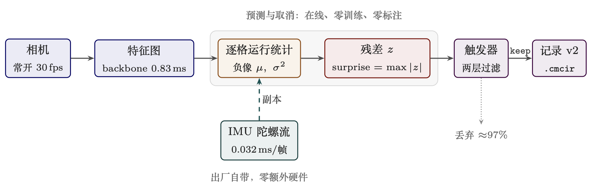
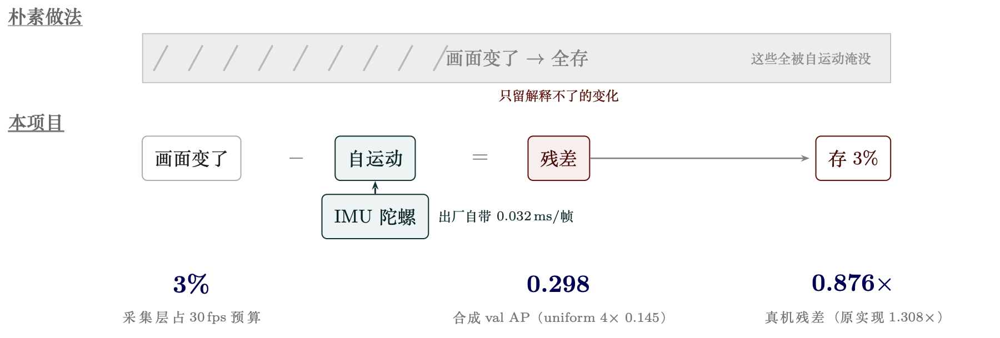
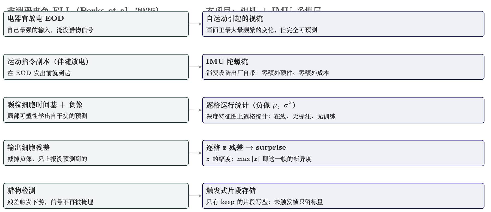

# 小脑式残差触发数据采集

[English README](README.md) | 中文 README

Perks et al.（Nature 2026, doi:10.1038/s41586-026-10690-6）讨论的想法的最小原型：**相机+IMU 一体化设备不应该存储它能预测的东西**。这套 pipeline 学习设备自身运动（伴随放电 = IMU）的感官后果的"负像"（negative image），只记录残差——即意外（unexpected）的部分。



一句话读上面这张图：**IMU 那一路（虚线）不是主链路，它是喂给"预测"的参照系。** 有了它，"画面变了"才能被拆成"这是我自己转的"和"这是外面真发生了事"——后者才存。

## 3 分钟版（时间紧就读这一节）



**怎么读这张图。** 上一行是**朴素做法**：把"画面变了"直接当成"有事发生"，于是
设备自己走路、转身、手持抖动全被算进去——信号被自运动淹没，只能全存（灰框表示
这条路走不通）。下一行是**本项目的做法**：多了一项减法——先用 IMU 陀螺学着预测
"自运动通常造成多大变化"，把它**减掉**，剩下的残差才是"自己解释不了的变化"，
只存这部分（约 3%）。

**为什么这个减法值钱。** 检测"什么重要"难（要在设备上做语义理解）；预测"什么
变化是我自己造成的"**容易**——因为设备出厂就带着运动传感器。所以这套东西
**零训练、零标注、~0.2 ms/帧**，消费设备自带 IMU 即可。结构借自神经科学
（弱电鱼的伴随放电取消），但优势是纯工程性的。

**三个数字的出处与边界。**
- **3%**：采集层全程 ~1.0 ms/帧（IMU 副本本身只要 0.032 ms），占 30 fps 帧预算的 3%。
  「只存 3%」是合成 rig 上的读数，真实桌面数据的中位数是 9.2%。
- **0.298**：合成基准上下游 val AP，打赢同预算均匀采样（uniform 4× 预算 = 51% 存储，
  AP 0.145）与 oracle（AP 0.191）。**真实数据上没有迁移**（§2.3.6–2.3.7）。
- **0.876×**：真机 IMU 段上残差降到基线的 0.876 倍（原先用 tan 近似平移是 1.308×，
  帮倒忙）。逐位重跑时的绝对残差已不可复现，**引用请用 ratio**。

**这张图没有画出来的、但同样重要的一半。** 残差**不等于语义重要性**。四轮独立
实验（下游训练价值 / 推理期守门 / 目标重定义 24 格 / 有标注上界）从不同方向逼近，
**边界落在同一处**：残差回答的是"哪些像素的运动我不能用自运动解释"（**相机侧**），
而"什么重要"是**世界侧**的语义问题。用一个相机侧的运动量去装世界侧的语义标签是
**范畴错误**——它注定为负，不是因为估计器弱，而是问题不在它的定义域里。

> ⚠️ **本文里所有的 ❌ 都是"定义域测量"，不是"方法失败了"。** 读之前先看
> [GUIDE.md §0.5](GUIDE.md) 的开头，否则容易把"量准边界"误读成"没做成"。

**真正的产出是两层。** ① 一个**定义域被量得很准**的估计器（适用域：运动去重 /
带宽预筛，成本低两个数量级）；② 一整套**不依赖任何单条研究主张**的工程交付层——
掉电安全的记录格式、可训练的多模态数据集容器、输入契约加固、采集完整性哨兵。
后者才是能直接用起来的东西。

---

## 怎么读本文的结论（先说，很重要）

本文有很多"残差不携带事件信息"、"合成优势不迁移"这类句子。**它们容易被读成对象的
性质，但它们全部是协议下的读数。** 我们**没有**测过"残差是什么"；测过的是：

```
⟨ 残差 , 具体标签定义 , 采样/预算协议 , 判据 , 数据分布 ⟩ → 一个数字
```

**换掉括号里任何一项，数字都可能变**，结论只对**那一个元组**负责。举例：

| 写法 | 它其实是什么 |
| --- | --- |
| "残差不携带事件信息" | 在**帧级二值、1–8 s 粗区间**标签下，对**训练价值/守门**判据不携带 |
| "主场假设不成立" | 在**那 10 段**、**LOO×25 seed**、**AP** 判据下 cerebellum ≈ uniform |
| "'运动越大越值钱'证伪" | 在**p95 71–75°/s 那 4 段**上 gyro 比 naive 差，不是"所有运动尺度" |

**这不是免责声明，是精确性要求。** 两件事都要看：

1. **元组宽窄决定结论强弱**：有些读数很强（"跨场景低于随机"在任何标签粒度下都难
   救回），有些弱得多（"oracle 最优"在 5 段上 +0.070、10 段只剩 +0.036）。
2. **但也不能因为协议依赖就说"换个协议也许行"**：有些维度已经被试过并堵死
   （标注粒度、目标定义、信号选择、读出方式），且**独立证据落在同一处**——那时
   说"边界真实"是有依据的。关键是**把试过的维度列出来**，而不是含糊说"未证实"。

每个否定性结论后面都该能回答"换掉哪一项可能不同、那一项试过没有"。详见
GUIDE.md §2.0（本文档不重复那些细节）。

## 映射关系


| 电鱼 ELL（论文）     | 本原型                                                       |
| -------------------- | ------------------------------------------------------------ |
| 电器官放电（EOD）    | 设备自身的运动                                               |
| EOD 指令的伴随放电   | IMU 陀螺仪数据流                                             |
| 颗粒细胞时间基       | 陀螺特征`[1, |gx|, |gy|, |gz|]`                              |
| 负像（可预测的反应） | 逐 cell 线性预测`w_fast + w_slow` + 慢负像 `neg`             |
| 联合性抑制/易化      | 局部反 Hebb 更新，无反向传播                                 |
| 快/慢可塑性配对      | `w_fast`（秒级）+ `w_slow`（长时），`w_fast` 被拉向 `w_slow` |
| 平衡放电率可塑性门控 | 逐 cell 门控：**当下正在"惊讶"的 cell 不学习**             |
| 输出 cell 残差       | 逐 cell z 分数化残差；内部 cell 取最大值 = surprise          |
| 猎物检测             | 触发式片段保存（带迟滞）                                     |



## 当前 demo 结果（合成 60 秒设备，6 个 surprise 事件）

```
method                recall  precision   stored  clips
cerebellum            0.83    1.00        0.093    5
naive_diff            0.00    0.00        0.034    1
uniform(matched)      0.17    0.20        0.083    5
uniform(5%)           0.00    0.00        0.050    3
```

朴素帧差法淹没在自运动里（即使设备旋转很平滑，recall 也是 0）；与 cerebellum 方法**相同存储预算**的均匀采样漏掉了 6 个事件中的 5 个。cerebellum pipeline 仍漏掉一个事件（最早的那个，此时统计量还在收敛）——见"诚实的局限性"。

## 快速开始

**一句话**：相机 + IMU 的采集层——用陀螺仪预测"我自己动了多少"，把这部分减掉，只存减不掉的画面。零训练、零标注、约 0.2 ms/帧。

完整项目指南（方法、成本账、包括负结果在内的全部实验、以及面向未来的交付物）
见 [`GUIDE.md`](GUIDE.md)（**开头是五分钟上手**），也有一份带书签大纲、
可点击跳转的 [`GUIDE.pdf`](GUIDE.pdf)。README 是概要，指南才是自包含的参考。

```bash
python3 -m venv .venv && .venv/bin/pip install -r requirements.txt
.venv/bin/python scripts/make_synthetic.py --seconds 60 --out data/synthetic
PYTHONPATH=. .venv/bin/python scripts/run_experiment.py data/synthetic
```

用它自己的数据：

```bash
# 有 IMU csv；没有 IMU 也可以（改用视觉估计，慢一些）
PYTHONPATH=. .venv/bin/python scripts/cmci.py run myvideo.mp4 --imu myimu.csv --out ./out
```

运行单元测试：

```bash
PYTHONPATH=. .venv/bin/python -m pytest tests/
```

一键跑完全部验收（测试 + 类型检查 + 文档引用审计 + manifest 审计 +
图重建 + GUIDE PDF 重建/自检）：

```bash
make check          # 快速失败，提交前跑这个
make check-all      # 跑完全部步骤再汇总
# 不依赖 make 的等价写法：
PYTHONPATH=. .venv/bin/python scripts/check_all.py
```

图用 TikZ 写（`figs/*.tikz`），一条命令同时产出**矢量 PDF**（嵌进
`GUIDE.pdf`）和 **PNG**（GitHub 上直接显示）：

```bash
.venv/bin/python scripts/build_figures.py   # figs/*.tikz → figs/*.pdf + figs/*.png
```

画幅是**量出来的，不是声明的**：脚本先在 A4 上排一遍、读出真实 box 尺寸，
再用那个尺寸重排。手写尺寸等于让作者猜——猜小了会**静默裁掉内容**。
`make check` 会在重建 PDF 之前先跑这一步，而 `scripts/verify_guide_pdf.py`
会断言嵌进 PDF 的图是**矢量**（Form XObject）而不是位图。

这套门禁有两处刻意从严：`tests/test_extract_featmaps_dino.py` 的 6 个既存
ERROR 被记成**期望基线**（既不会掩盖新失败，也不会悄悄增长）；交付物
（`cerebellum_cancel/`、`tests/`）必须保持 **0 类型错误**，而 `scripts/`
下的一次性探查脚本只要求"不新增"。它在头几次运行就抓到两个真问题：四份
文档引用了一个不存在的 `scripts/eval_weight_value.py`，以及 `scripts/` 里
4 个此前从未被任何检查看过的 pyright 错误。

本仓库的一个自包含子集（包 + 最小脚本 + 测试，不含数据集）打包在
`public_edition/` 里。它装的是**在线采集层**：取消（`core`、`featmap_cancel`、
`rotwarp`）、可插拔的 `acquisition` API、`pipeline`，以及输入 `contracts`。
离线数据集层（`integrity`、`dataset`）**刻意不含**——上面那些结论都不依赖它，
它的契约测试也一并省略。其中的 `scripts/demo_video.py` 可以把任意序列渲染成
并排 demo 视频（原始帧 | 残差热力图 | HUD）——同一脚本也有一份在根目录
`scripts/demo_video.py`：

```bash
cd public_edition && pip install -r requirements.txt
PYTHONPATH=. python scripts/make_synthetic.py --out demo_scene
PYTHONPATH=. python scripts/run_experiment.py demo_scene   # cerebellum recall 1.00 vs uniform 0.17
PYTHONPATH=. python scripts/demo_video.py --src demo_scene --out demo_video.mp4
```

`make check` 也会看住这个子集：共享文件必须与主版**逐字节一致**，且它的测试
必须在隔离目录下通过。加这条检查是因为这个子集曾经悄悄落后主版几个月
（缺 6 个模块、4 个共享文件已漂移）而**它自己的测试照样全过**——是一种没有
任何信号的过期。把取舍说清楚：子集是**副本不是分支**，所以任何修改都应先
落在主版再同步；直接改 `public_edition/` 会被判为漂移。

## 用 iPhone 真实采集

1. **视频**：用相机 app 录制（1080p30 足够）。
2. **IMU**：运行 *Sensor Logger*（或任何能导出 CSV 的 app），陀螺仪 ≥100 Hz。期望的列：`time,gyroscope.x,gyroscope.y,gyroscope.z`。
3. **同步**：在场景开始前，用力摇一次手机。尖峰在视频和陀螺仪模长中都可见；计算 `imu_offset = t_shake_video - t_shake_imu` 并传入 `--imu-offset`。
4. **真值**：标注 `events.json`：`{"events": [[t0, t1], ...], "fps": 30}`，写入所有应该被记录的时间戳。
5. 运行：`PYTHONPATH=. .venv/bin/python scripts/run_experiment.py data/my_rec`

## 首次真实采集（ webcam，桌面场景）

一段 65 秒的桌面录制，外接 webcam（30 fps）+ 手机陀螺仪数据流（用摇手机技巧同步，`imu_offset` 11.342 秒），6 个标注事件：

```
method                recall  precision   stored  clips
cerebellum            0.33    0.50        0.102    4
naive_diff            0.00    0.00        0.042    2
uniform(matched)      0.17    0.17        0.092    6
uniform(5%)           0.17    0.33        0.046    3
```

相对排序在真实数据上成立（同预算下 cerebellum > 基线），但绝对 recall 从 0.83 掉到 0.33：抓到两个靠后的事件，漏掉四个较早的，且有一个早期片段（5.5–8.9 秒）是误触发。60 秒的桌面场景恰好是 README 局限性预言的困难 regime——自动对焦呼吸效应、曝光自适应、细微背景运动——在负像吸收它们之前，这些都会表现为"surprise"。这段录制早于多时间尺度调优，仍使用手调阈值；把它当作可行性验证（真实传感器噪声不会破坏 pipeline）而非性能测量。

复现：

```bash
PYTHONPATH=. .venv/bin/python scripts/run_experiment.py data/webcam_rec
```

## Adapter 实验：小脑作为冻结 backbone 的插件

把映射从信号层扩展到**现代 CV 技术栈**：冻结一个 ImageNet 预训练的 MobileNetV3-small（576 维池化特征），在后面插入一个小脑 adapter，检验 adapter 的残差是否对下游事件头有帮助。

Adapter（`cerebellum_cancel/adapter.py`）：固定随机颗粒扩展 `phi([f_{t-1}, a_t])` -> 线性预测器 `W_slow`（训练集上 ridge 回归）+ `W_fast`（在线，单位模长门控的反 Hebb，向零衰减）；当下令人惊讶的帧不更新任何参数（平衡放电率门控）；输出 = z 分数化残差 `r_t = (f_t - f_hat_t) / sd`。

基准（`data/dataset`）：50 条合成序列，纹理场景 + 平滑自旋转 + IMU；训练用 1x 运动幅度，验证用 3x（regime shift）。事件 = 物体出现/移动。慢预测器 R^2 = 0.971。

```
variant            AP@1    AP@4   AP@16   AP@40   evRec@10%
A_static          0.536   0.871   0.842   0.815        1.00   （原始特征上的头）
B_slow_only       0.223   0.185   0.157   0.162        1.00   （残差上的头，W_slow）
C_cerebellum      0.193   0.179   0.171   0.186        1.00   （残差上的头，W_slow+W_fast）
C_energy             --      --      --   0.325        0.76   （未训练的 sum(z^2) 读出）
```

**诚实的负面结果。**在这个基准上，adapter 在任何配置下（已训练/少样本/未训练读出）都没有打过原始冻结特征。按根本程度排序的原因：

1. **池化深度特征本来就对运动鲁棒。**1-4 秒的运动 regime shift 完全不伤 A——训练出的头能找到对 blob 敏感的维度，运动变化是可学习的背景。取消机制没有移除任何头自己无法忽略的东西。
2. **残差噪声无法被学习消除。**原始特征 = 信号 + 稳定背景（训练出的头免费减掉背景）；残差 = 信号 + 运动预测噪声（*池化*特征上的线性映射无法表达"内容平移了 k 像素"，所以自运动泄漏进残差）。除非预测器接近完美，取消就是用可移除的背景去换不可移除的噪声——在这里这笔交易是亏的。
3. **事件太显著了。**纹理背景上的白色 blob 在特征空间里 trivially 可分；ELL 的优势（surprise 从被抵消的背景中凸显）需要相对于可预测结构更微妙的事件。

*站得住的部分*：B/C 的 AP 在 1x->3x 运动 regime shift 下不变（两个 regime 都是 0.15-0.19），尽管只在 1x 上训练——残差确实具有运动不变性，且 W_fast 现在能稳定学习（一个最初的 LMS 发散 bug：`fast_lr=0.02` 对比稳定界 `2/||phi||^2 ~ 0.016`，通过单位模长归一化颗粒输出修复）。强版本的机制仍然是像素空间的那个（见上面的"当前 demo 结果"），其特征空间形式就是下一节的几何变体。
*（在显著事件数据集上测得；当前默认数据集是下面使用的 open-set 变体。）*

复现：

```bash
PYTHONPATH=. .venv/bin/python scripts/make_dataset.py --n-train 40 --n-val 10 --seconds 20
PYTHONPATH=. .venv/bin/python scripts/extract_features.py data/dataset   # 需要 torch+torchvision
PYTHONPATH=. .venv/bin/python scripts/train_adapter.py data/dataset
```

## 特征图取消（几何式，无训练）

上面的池化特征 adapter 失败是因为*池化*特征上的线性映射无法表达"内容平移了 k 像素"——自运动作为不可学习的噪声泄漏进残差。本模块是空间结构化的修复方案，也是 ELL 负像更接近的类比：

- backbone 特征图 `F_t`（MobileNetV3-small `features[:3]`，24x28x28，冻结，保留空间结构）；
- **预测** `F_hat_t(x) = F_{t-1}(x - dx_t)`，其中 `dx_t` 来自 IMU 陀螺仪（伴随放电），换算成特征图像素——`dx = f_map * tan(radians(gyro) / fps)`（符号经实测验证）；
- **残差** `r_t = F_t - F_hat_t`，用逐 cell 运行统计量做 z 分数化，统计量只在平静帧更新（平衡放电率门控；warmup 帧无条件引导统计量）；
- **读出**：无训练——池化 z 能量，或最强的内部 cell。全程无任何训练。

基准：同样的 50 条序列，但现在是 open-set 版本——训练事件是微弱 blob（alpha 0.3），3x 运动的验证事件是**不同屏幕区域的微弱长条：一种从未被任何训练头见过的形状**。

```
                          val AP   evRec@10%      （25 条验证序列）
gyro_warp + maxcell        0.304       0.64   （无训练 —— 全场最佳）
gyro_warp + energy         0.209       0.49   （无训练）
C cerebellum (pooled)      0.182       0.91   （残差上训练）
B slow-only  (pooled)      0.165       0.91
naive_diff + maxcell       0.171       0.51   （无训练，无 warp）
naive_diff + energy        0.172       0.34
A static head (pooled)     0.119       0.64   （原始特征上训练 —— 崩溃）
```

三个结论，由弱到强：

1. **陀螺 warp 有效。**平静帧残差下降 2.6 倍（0.48 -> 0.18），且每个 gyro_warp 读出都胜过其 naive_diff 对照（在 3x 运动下）。
2. **surprise 表示可迁移；外观表示不可。**A 的在原始特征上训练的头在未见事件类型上崩溃（recall 0.46）；在*残差*上训练的头保持 0.8-0.9 recall——它们学到的是噪声模型，不是事件本身。
3. **一个固定的、未训练的前端 outright 赢得 open-set regime。**gyro_warp + maxcell（0.271 AP）胜过所有已训练头的变体，零训练、零事件类型假设——架构固化：对齐、局部门控、一个平凡的读出，就是全部机制。

注意：绝对 AP 都不高（3x 运动下的微弱长条对所有方法都很难）；验证集从 10 扩到 25 条时 open-set 优势保持（gyro_warp+maxcell 0.271 -> 0.304 AP，排序不变）；"无训练"仍假设陀螺-平移标定（f_map）已知。

复现：

```bash
PYTHONPATH=. .venv/bin/python scripts/make_dataset.py --n-train 40 --n-val 25 \
    --seconds 20 --event-alpha 0.3 --val-event-shape bar
PYTHONPATH=. .venv/bin/python scripts/extract_featmaps.py data/dataset
PYTHONPATH=. .venv/bin/python scripts/run_featmap_eval.py data/dataset
```

## 下游训练对比（headline claim，已实测）

一个只存储 cerebellum 触发片段的设备，训练下游模型是否**每存储字节更好**？训练帧由各方法在 40 条训练序列上按匹配存储预算采样；下游模型与 adapter 实验相同（冻结 MobileNetV3 特征上的 LogisticHead）；评估在完整的 25 条验证序列上进行（帧级 AP、top-10% 预算下的事件 recall）。片段来源是上面的特征图取消前端（gyro warp + maxcell z^2 读出）——已实测像素空间触发器在此数据集上完全不触发（训练事件微弱，alpha 0.3；其 z < 6 持续门控需要显著事件：阈值降到 2.5 时 recall 也仅 0.13）。

触发是**自校准的**（`AdaptiveTrigger`）：原始 z^2 分数先除以其自身平静帧运行统计量，再进入无量纲 6/2.5 迟滞门控，因此无需手调分数阈值。之前手调的工作点（T=300）保留为参照行。

```
method                stored  frames   val AP   evRec@10%
cerebellum (adaptive)  0.034     826    0.298       0.96
uniform(0.5x)          0.061    1457    0.135       0.58
uniform(1x)            0.074    1766    0.131       0.59
uniform(2x)            0.091    2181    0.125       0.58
uniform(4x)            0.121    2894    0.120       0.57
oracle(adaptive)       0.019     449    0.191       0.72
--
cerebellum(T=300)      0.150    3593    0.210       0.92   （手调参照）
```

结论，由弱到强：

1. **cerebellum 片段在 4 倍字节预算下仍胜 uniform。**3.4% 存储（826 帧）时 AP 0.298 / evRec 0.96；uniform 需要 3.5 倍帧数（12%）仍大幅落败（0.120 / 0.57）。
2. **赢在数据，不在预算。**加大 uniform 预算无法缩小差距（超过 0.5x 后反而更差——背景更稀释），所以优势来自事件富集，而非存储量。
3. **cerebellum 片段甚至胜过 oracle**（预算全花在真值事件帧上），两项指标皆胜（evRec 0.96 vs 0.72）。触发片段保留了事件 onset、消失和运动边界上下文——正是判别式头需要的帧——而 oracle 只保留事件中段帧。
4. **自校准胜过手调阈值。**自适应触发器比 T=300 工作点少存 4.3 倍帧，且训练出更好的头（AP 0.298 vs 0.210）——用轨迹自身平静统计量归一化是比任何固定原始阈值更锐的判据。

Regime 检查（验证集，3x 运动，平均存储占比）：adaptive 0.339 vs T300 0.379。两者在 regime shift 下都膨胀——calm 门拒绝把运动爆发吸收进基线（设计使然），所以噪声大 3 倍的设备仍按比例存更多。自校准买到的是工作 regime 内的精度，不是 regime 不变性；对一个持续新运动水平的慢时间尺度吸收需要比 20 秒更长的流。

Head 稳健性（同样片段、更强下游模型）：把 LogisticHead 换成 128 隐层 MLP **并没有**提高验证 AP——反而降低了（cerebellum adaptive：0.298 -> 0.200；一组 5 配置的正则化扫描——隐层/l2/dropout/迭代数——最高 0.247）。验证 regime（3x 运动 + 未见过的长条形状）惩罚容量：MLP 过拟合训练片段中运动特有的相关性，这与 adapter 节为基于外观的头记录的失败相同（"surprise 表示可迁移；外观表示不可"）。MLP 确实改进了的是排序的头部（cerebellum 片段上 evRec@10% 0.96 -> 0.99-1.00）。在所有 head 和配置下，数据价值 claim 不变：cerebellum 片段在所有匹配预算下胜过 uniform，并在事件 recall 上胜过 oracle。在这个基准上，AP 受限于数据，而非模型。

注意：字节预算用帧数近似（每帧码率按构造跨方法相近）；冻结特征提取器假设随设备部署（adapter 一节的前提）；6/2.5 仍是人为选择的常数，只是无量纲；下游头刻意做小——claim 是关于*每字节数据价值*，而非检测器峰值性能（下文实测了更强的 MLP 头：它并不能提高 AP）。

复现：

```bash
PYTHONPATH=. .venv/bin/python scripts/train_downstream.py data/dataset
```

## 光流基线与成本画像

陀螺 warp 的 CV 原生替代方案是稠密光流：用图像内容自身的运动来补偿，不需要 IMU。在本基准上端到端实测（`cerebellum_cancel/flow_cancel.py`，DIS MEDIUM 档；15 条训练 + 5 条验证序列）：

```
                    平静帧残差（mean |err|）    存储占比  evRec
                    训练 (1x)   验证 (3x)      验证(3x) 验证(3x)
naive（无 warp）       0.093       0.221          --      --
gyro warp             0.079       0.129         0.113   0.30
DIS 光流 warp          0.070       0.103         0.192   0.33
```

**更强的光流估计器在这里打不过 DIS。**把 RAFT（Teed & Deng, ECCV 2020,
raft-things 权重）接进同一条 warp 路径（`scripts/run_raft_eval.py`），
回答"flow 上限会不会只是 DIS 太弱造成的假象"：

```
                    平静帧残差（mean |err|）      ms/帧
                    合成验证集   真实高运动（224px, robust）
naive                 0.221          0.080               --
gyro warp             0.129          0.090             0.033
DIS 光流 warp          0.106          0.052         5.9 / 7.4
RAFT 光流 warp         0.105          0.054       134 / 138
```

（合成验证集 5 条；真实高运动 2 条。）RAFT 在合成上与 DIS 打平
（0.1054 vs 0.1056），在真实上略差（0.0544 vs 0.0522），同时慢 ~20 倍。
flow 上限是任务本身的属性，与估计器无关；gyro 与 flow 的残差差距
无法靠换学习式光流模型弥合。

```bash
PYTHONPATH=. .venv/bin/python scripts/run_raft_eval.py data/dataset --split val --n-seq 5
PYTHONPATH=. .venv/bin/python scripts/run_raft_eval.py data/aoe_motion --split val --n-seq 2 --robust
```

本机每帧延迟中位数（320x240 帧，24x28x28 特征图）：

```
阶段                      ms/帧
gyro shift (24x28x28)     0.032
pixel pipeline 核心        0.171   （warp + 网格 + 可塑性 + 触发器）
冻结 backbone 前向         0.827   （MobileNetV3 features[:3]，224x224，MPS）
DIS 光流 (320x240)         3.813
完整 flow-cancel 步        4.456
```

结论：

1. **光流确实买到残差质量**——平静帧残差比 gyro warp 低 11%（1x）/ 20%（3x）（DIS 追踪的是内容的真实位移，包括陀螺近似漏掉的部分）。这是真实存在的、光流基线最大的优势。
2. **代价是整个像素 pipeline 的 26 倍**（4.5 ms vs 0.17 ms 每帧，仅 warp 一步就差 ~120 倍）——30 fps 预算下像素 pipeline 占帧时间 0.5%，flow 步占 13%。且这些计时是在笔记本上；在端上（手机 CPU、无 MPS）DIS 通常还要慢好几倍。
3. **它依赖纹理和稳定性**：快速运动下 DIS 会跟丢（一条 3x 验证序列存了 59% 的流，gyro 只有 13%——光流噪声会被当成 surprise）；无纹理或低光区域无解，而 gyro warp 不受影响。事件区域会污染局部流场，泄漏进残差。
4. **架构层面的解读**：gyro warp 是一个 ~30 微秒的矩阵运算，把 IMU 变成了伴随放电；光流是一个每帧都要跑的计算机视觉计算，而且必须先于它服务的补偿步骤执行。对于一个以*廉价常开*的惊讶检测为全部意义的设备，IMU 是对的层次——光流是用来对照的质量上限（已用 RAFT 确认与估计器无关），残差质量差距（11-20%）是 100 倍成本比下诚实的代价。亚像素 gyro shift 和更好的 f_map 标定能缩小这部分差距。

**跨平台可移植性**（`scripts/run_portable_check.py`，`runs/portable_check.json`）：唯一依赖设备的阶段是冻结 backbone 前向。同一批帧在 CPU vs MPS 下：特征最大相对差 2e-6，下游 gyro 平静残差差 3.7e-9——取消路径在数值上可跨设备复现。延迟：backbone CPU 1.76 ms vs MPS 1.06 ms（仅 1.7 倍），管道在 CPU 上仍远低于 30 fps 的单帧预算。剩余的未测量边界是手机级硬件（无笔记本 MPS、核更慢）。

复现：

```bash
PYTHONPATH=. .venv/bin/python scripts/run_flow_eval.py data/dataset
```

## 分辨率：决定 gyro warp 值不值的旋钮

gyro warp 只能移除特征图*看得见*的运动。同样的旋转产生的内容位移是 `f_map * tan(omega/fps)` 个特征图像素，而 `f_map` 随 backbone 输入尺寸线性缩放。用三个输入尺寸重跑同一基准（同样的 40 训练 + 25 验证序列，MobileNetV3 features[:3]，stride 8；224 px 时 f_map 24.25 是 rig 默认值），把分辨率单独作为变量：

```
输入    特征图    f_map   平静帧残差（验证集）  gyro 收益   gyro shift   DIS 光流
        尺寸             naive   gyro   flow   vs naive  ms/帧        ms/帧
224     28x28    24.25   0.221   0.130  0.107  -41%       0.032        3.86
336     42x42    36.38   0.187   0.089  0.069  -52%       0.061        4.20
448     56x56    48.50   0.169   0.072  0.052  -58%       0.087        4.35
```

（backbone 前向在 MPS 上各尺寸都 ~0.6 ms/帧——浅层 stride-8 是访存瓶颈；分辨率的协议成本在存储和带宽，不在算力。同一会话重测，`runs/flow_eval_res*.json`。）

收益单调且未饱和：每提高 1.5 倍输入尺寸，就多消掉 6-10 个百分点的 naive 预测器动不了的平静残差。与光流的差距也随分辨率收窄（flow/gyro 0.82 → 0.73）：gyro warp 的主要误差源——位移的亚像素量化——随特征图变精细而缩小。这也反向解释了真实数据的两个 regime：桌面级 Open-AoE 在 224 px 下 f_map ~11-19、旋转 < ~5°/s（位移 < 0.05 特征图像素——没东西可消，warp 中性）；而 p95 |yaw| 31-52°/s 的高运动对在 ~0.5-0.7 特征图像素——进入了模型误差（roll 未建模、标定）开始*增加*残差而非消减的窗口。

协议层设计规则：**伴随放电取消是一个被分辨率门控的原语**——配细粒度特征（DINOv2 patch token，或 ≥448 px 输入的 stride-8 特征图），它用 ~0.09 ms/帧消掉一半可预测残差；在粗特征图上它免费但中性。（2026-09-09 更新：该配对中的 DINOv2 patch token 半侧已实测并关闭——residual-trigger 操作点上 ViT patch token 最多触发 3/40 段，MNV3 为 11/40；见下文"Backbone 替换路线关闭"。规则本身对 stride-8 卷积特征图仍然成立，那是它被实测过的版本。）同一个变量也决定*触发器*是否工作：448 px 下门控自归一化触发器在全部 5 条合成验证序列上冻到 0 clips（基线 surprise 随分辨率增长并重尾化），而 winsorized 稳健统计在 5 条上全部触发——真实视频的门失效，在合成数据上复现了。

复现：

```bash
# 其它输入尺寸的 featmaps；f_map 线性缩放（24.25 * size/224）
for S in 336 448; do
  .venv/bin/python scripts/extract_featmaps.py data/dataset_$S --size $S
  PYTHONPATH=. .venv/bin/python scripts/run_flow_eval.py data/dataset_$S \
      --n-train 40 --n-val 25 --size $S
done
```
（`data/dataset_$S` 目录里是帧的符号链接、`imu.csv` 副本和缩放过 `f_map` 的 `events.json`；可随时删除重建——featmaps 几分钟就能重提。）

## 光流仲裁级联

介于"只用 gyro"和"每帧跑光流"之间的中间架构：gyro warp 常开；DIS 光流**只在触发候选帧上**被调用，作为仲裁者否决它能解释的候选。每个候选 run 峰值帧的组成方式（`scripts/run_arbiter_eval.py`）：gyro shift 同时预校正灰度帧对（这样 DIS 只需搜索 gyro 模型预测漏掉的小残差——不做预校正时 DIS 在大旋转下跟丢，而触发恰恰在那里开火）和 F_{t-1}；然后 DIS 沿残差流精化预测。当光流精化后的残差内部能量 < gyro 残差的 `explain_ratio`（0.5）时否决该 run——即该残差是自运动建模误差，不是 surprise。

全基准实测（15 训练 + 5 验证，run 级读数——固定阈值 run，与 `AdaptiveTrigger` 的自适应 clip 不同，它对 trace 是单调的）：

```
                 stored   precision   evRec   DIS 调用/序列   摊销 ms/帧
train gyro        0.401      0.257      1.00        --            --
train cascade     0.401      0.257      1.00       21.3         0.135
val   gyro        0.520      0.146      1.00        --            --
val   cascade     0.498      0.155      1.00       23.6         0.150
```

诚实解读：在此合成基准上级联几乎是一个 no-op（118 个验证 run 只否决 6 个）。这是基准的*实测*属性，不是仲裁器的弱点——三条机制解释，每条都验证过：

1. 合成基准是纯全局 yaw/pitch 平移（roll < 1 度/秒），恰好在 gyro warp 的模型类内，所以 warp 近精确，平静帧残差是特征噪声而非建模误差（光流精化后的残差能量 ≈ gyro 残差能量，比值 1.03–1.27）。
2. 在 28×28 特征图上，亚像素标定误差仍在特征噪声下限之下：把 f_map 拉偏 10–50% 后 `rho` 仍 ≈ 1，不会触发否决（评估脚本的 `--fmap-scale`）。
3. 仲裁器*本来能*抓到的东西——全局平移模型无法表达的结构化残差（真实 roll、视差/深度、大标定误差）——在这份数据里不存在。

所以级联的当前定位是：机制与成本已验证（摊销 ~0.15 ms/帧，比每帧跑 DIS 便宜 ~25 倍，需要时保留否决权），价值待真实相机验证——它恰好是为合成基准所缺的那些失效模式准备的安全网。run 级读数还暴露了 `AdaptiveTrigger` 的_running 归一化不是单调的_（清零一个被否决的 run 可能让后续 clip *更敏感*），级联评估通过在固定阈值 run 级对比回避了这一点。

```bash
PYTHONPATH=. .venv/bin/python scripts/run_arbiter_eval.py data/dataset
```

## 真实第一人称验证（Open-AoE）

合成 rig 是纯全局 yaw/pitch，所以第一次真实世界检验使用 [Open-AoE](https://github.com/ant-research/Open-AoE)（HF 上的 inclusionAI/OpenAoE-2000h）：~700 小时消费级手机第一视角视频，带视觉 SLAM 相机轨迹和时间对齐的原子动作标注。从 60 段探测样本中用 `scripts/fetch_aoe.py` 按场景/动作多样性贪心挑选了 9 个 segment（浴室/卧室/儿童房/餐厅/厨房/客厅/工坊/工作台/商店，各 134–301 秒，8 段共 62.0k 帧），用 `scripts/prep_aoe.py` 准备：对 `cam_c2w` 差分得到 pipeline 期望的 gyro 式信号（逐轴符号对照 DIS 流自标定，|r| = 0.18–0.93，最差的两段是几乎静止的画面，没有运动可供相关），写出标准序列布局，并使用每部手机真实焦距（`f_map` = 10.95–19.17，fx 751–1315，而非合成 rig 的 24.25）。

先在一个 segment（seq_000）上实测，再推广到全部九个——三条合成 rig 给不出的发现：

1. **真实自运动在 28×28 上是亚像素的**。内容位移中位数 0.013 特征图像素（p95 0.05，max 0.16），所以 gyro warp 在物理上是中性的：平静残差 naive 0.0323 vs gyro 0.0328。伴随放电 warp 只有在更细分辨率、更深层特征、或行走级运动下才物有所值——桌面第一视角 + 224 px 输入的场景里用不上。
2. **平衡门在真实数据上会冻结**。96.4% 的帧 surprise > 4，warmup 之后运行统计只在 3.6% 的帧上更新，sd 单向衰减（0.92 → 0.17）；z 饱和（max|z| 中位数 = 13），两种读数朝相反方向退化：固定阈值 run 覆盖全部帧的 92%，而 `AdaptiveTrigger` 的相对归一化**一次 clip 都不触发**。平静门假设（surprise 是稀疏的）对 pop-in 式合成事件成立，对真实视频不成立。修法是 winsorized always-update 统计（`CancelConfig.robust`）：离群值以 3 倍 sigma 截断后进入运行统计，既撑不大尺度也不会把门冻住。换成稳健统计后触发器恢复工作：**stored 9.9%、事件 recall 0.79（此前为 0 clips）**。一个有力的旁证：DIS 光流基线（`FlowWarpCancel`）共用同一套门控统计，在真实视频上同样 0 clips——失效的是门，不是预测器。
3. **残差尖峰是真实的，但与动作标注不对齐**。残差最高的帧是快速手/物体运动+运动模糊（`runs/aoe_peaks/`），但分数与标注的动作区间*反*相关（AUC 0.47）：原子动作是运动能量起伏的长区间，而残差索引的是运动瞬变。因此帧级 event-recall 对照人类动作标注在真实数据上是错误指标；对残差触发*存储选择*架构来说，有意义的指标是被选片段的下游价值（见上节），而不是标注对齐。

三条发现在全部九个 segment 上都成立：gyro-warp 的平静残差与 naive 的差别从未超出噪声（各段自运动都是亚像素，内容位移中位数 < 0.05 特征图像素）；稳健统计触发器在每段都工作（stored 1.2–13.1%，中位 9.2%；对动作标注的事件 recall 0.14–0.79，中位 0.46——seq_000 上的离散结论，现在带上了误差范围）；DIS 光流基线在同一套门控统计下依然大多 0 clips，除了光流自己产生幻觉触发的一段（seq_004：stored 99%）。每序列数字见 `runs/flow_eval.json`。

run 级别的光流仲裁同样推广（`runs/arbiter_eval.json`）：九个片段上稳健统计产生约 140 个候选 run/段，级联否决其中的 8–31%（光流调用摊销到 0.89 ms/帧），把被标记帧的存储量从 0.89 降到 0.72，precision 保持 0.994，事件 recall 1.00 → 0.94；clip 级别上 AdaptiveTrigger stored 7.9% → 20.6%、recall 0.49 → 0.55——被否决的 run 即便在亚像素位移下也主要由自运动建模误差主导。

**高运动端**（259 段探测池里运动 top 的 2 段，p95 |yaw| 31–52°/s，桌面片段为 1–41；`data/aoe_motion`、`runs/flow_eval_motion.json`）终于离开了亚像素 regime——预测器的排序随之翻转，但带保留。平静残差：gyro warp 现在比 naive *更差*（0.090 vs 0.080；二维平移模型不补偿 roll，且该段符号标定更弱，仓库段 y r = 0.15），而 DIS 光流在质量上明确胜出（0.052）——成本上则以 ~250 倍落败（8.4 ms vs 0.033 ms/帧）。稳健触发器也变稀（stored 1.4%/1.2%，evRec 0.09/0.04）：连续真实运动让残差重尾化，winsorized sd 膨胀，z 阈值水涨船高。仲裁正是这个 regime 的桥：在最活跃的片段上否决 11% 的 run（stored 0.92 → 0.62，precision 1.00，摊销 0.58 ms/帧）。诚实的底线：在这个语料上即使 top-decile 的旋转量在 28×28 上也只有 ~0.5 特征图像素/帧，所以 gyro warp 在该分辨率下的质量窗口很窄——它的理由是成本，光流仲裁是廉价模型失效时的付费升级。（n=2，且上述标定保留成立。）

**448 px 分辨率交叉验证**（同一对片段，特征图翻倍至 38×38；`data/aoe_motion_448`、`runs/flow_eval_motion448.json`）：设计规则"特征越细 gyro warp 越值"——在合成数据上单调成立（224/336/448 收益 -41%/-52%/-58%）——**不能迁移到真实高运动**。gyro 依然比 naive 差（0.0535 → 0.0614，+15%），DIS 光流逐段翻转（走廊段 0.086、仓库段 0.051；均值 0.068，两段中有一段比 naive 还差）。在真实数据上，损伤主要由纯旋转模型看不见的东西主导——平移/视差、滚动快门畸变——而更多像素让它们*更显眼*而非更不显眼。分辨率修的是估计器误差，修不了模型类误差。下一个要补的模型缺口是平移，不是分辨率——而补平移比看起来难：

**平移项：实测，负收益**（`scripts/run_trans_eval.py`、`runs/trans_eval_data_aoe_motion_val.json`）。SLAM 轨迹同样能差分出 cam 系平移速度，`prep_aoe.py` 会逐段标定一个常深度比例（1/Z，对 DIS 流最小二乘——与 gyro 符号标定、f_map 同级）。在高运动对上，旋转+平移 warp 比纯旋转*更差*（calm residual 0.0901 → 0.0938，两段皆然）。均匀平移解释了均值流却造成逐格错位：真实场景深度结构化（走廊近墙和远端移动不同），常深度模型类是错的，任何逐段标量标定都修不了。平移补偿要么带深度结构（单目深度、平面模型），要么留在按需光流仲裁那条路上。

```bash
# re-prep 会写出平移列 + 逐段 trans_scale
PYTHONPATH=. .venv/bin/python scripts/prep_aoe.py data/aoe_src/<segment> \
    --out data/aoe_motion/val/seq_XXX
PYTHONPATH=. .venv/bin/python scripts/run_trans_eval.py data/aoe_motion \
    --split val --n-seq 2
```

```bash
# 挑选 + 下载 segment（probe -> select -> fetch，每步有缓存）
.venv/bin/python scripts/fetch_aoe.py probe --n 60
.venv/bin/python scripts/fetch_aoe.py select --k 8
# 高运动 regime：先按轨迹旋转量过滤再选
.venv/bin/python scripts/fetch_aoe.py select --k 3 --motion-min 60
.venv/bin/python scripts/fetch_aoe.py fetch
# 逐个转换为标准序列布局
for d in data/aoe_src/<segment>; do
  PYTHONPATH=. .venv/bin/python scripts/prep_aoe.py "$d" --out data/aoe/val/seq_XXX
done
PYTHONPATH=. .venv/bin/python scripts/extract_featmaps.py data/aoe
PYTHONPATH=. .venv/bin/python scripts/run_flow_eval.py data/aoe --n-train 0 --n-val 9 --robust
PYTHONPATH=. .venv/bin/python scripts/run_arbiter_eval.py data/aoe --n-train 0 --n-val 9 --robust
```

## 真实数据下游价值（判据失效，已更正）

合成的 headline 结论（cerebellum 片段每存储字节训练价值更高）**在真实视频上暂时测不出来**
——不是“已否证”，而是我们试的两个判据都没有分辨力（§2.3.6 于 2026-09-13 更正）。

任务层面被数据强制改了一处："主动操作"标注在 9 段中的 8 段覆盖 ~100% 帧，binary 事件检测任务退化。真实数据任务改为帧级动词分类：取原子动作标注中 7 个目标动词（fold、grasp、insert、set_down、thread、unfold、wipe，每类在训练/验证两半各 ≥300 帧；`scripts/make_verb_labels.py`），one-vs-rest logistic 头 + 冻结 576 维 pooled 特征，6 段训练 / 3 段验证（`scripts/train_downstream_aoe.py`、`runs/downstream_aoe_results.json`）：

```
方法              存储占比  帧数    val mAP  区间recall@10%
cerebellum        0.071    3296    0.197      0.75
uniform(0.5x)     0.035    1643    0.209      0.68
uniform(1x)       0.071    3317    0.192      0.75
uniform(2x)       0.143    6696    0.204      0.77
uniform(4x)       0.290   13516    0.193      0.73
oracle            0.056    2528    0.203      0.80
```

触发器本身工作正常（stored 7.1%、区间 recall 0.75），但选中的帧不是判别帧：残差触发存的是*运动学上不可预测*的帧（运动突变），而动词身份是语义信息、分布在整个操作区间——与残差峰对动作标注帧级反相关的实测（AUC 0.47，见上）一致。mAP 散布（0.19–0.21）在噪声量级；单 split、无 seed 误差棒——下一节的 3-fold CV 重测取代本表。当时给出的适用范围结论（"价值主张在它设计的稀疏物理事件 regime 成立"）是仅剩的逃生舱；下面做了主场正面检验，证伪。

```bash
PYTHONPATH=. .venv/bin/python scripts/extract_features_aoe.py data/aoe
PYTHONPATH=. .venv/bin/python scripts/make_verb_labels.py data/aoe
PYTHONPATH=. .venv/bin/python scripts/train_downstream_aoe.py data/aoe
```

## 真实数据下游价值：CV 重测（负结果确认）

上面的单 split 表已被跨段重测取代：12 段（新增 3 段）、9 类动词
（fold/grasp/hold/insert/lift/set_down/thread/unfold/wipe，每类在
split 两半各 ≥300 标注帧），3-fold 跨段 CV × 35 seed = **105 轮/方法**，
robust 触发（`scripts/run_downstream_aoe_cv.py`、
`runs/downstream_aoe_cv.json`）：

```
方法              存储占比  val mAP        区间recall@10%
cerebellum        0.160   0.161±0.078    0.67±0.12
uniform(0.5x)     0.081   0.176±0.089    0.72±0.08
uniform(1x)       0.161   0.173±0.081    0.68±0.07
uniform(2x)       0.240   0.174±0.089    0.71±0.06
uniform(4x)       0.400   0.169±0.082    0.71±0.09
oracle            0.132   0.164±0.089    0.72±0.09
all(100%)         1.000   0.166±0.083    0.71±0.08
```

早版的 0.197 是单 split 采样噪声。**但最后一行说明本表不该这样读**：
存 100% 的帧与只存 8% 得分相同，多用 12 倍数据分毫无涨——这个任务对
「多存哪些帧更好」没有分辨力。加上它按语义定义重要、本层按运动定义，
两套定义本就不该互相预测，所以**它既不能证明、也不能否证本层的价值**。
本表的 oracle 也退化：48%–100% 的帧带动词标注，照真值挑等于随便挑。

**真实视频上站得住的是这些**（§2.3.11）：补偿机制真的在工作（把陀螺仪
打乱或翻转，+0.045 的增益立刻变成 −0.063/−0.065，10/11 段变成 1/11 段），
筛选也在按预期工作（扔掉 84% 的帧，下游仍在 67% 的区间里找到动作）。
残差给的是**物理上出乎意料**的帧，不是**内容上重要**的帧。

```bash
PYTHONPATH=. .venv/bin/python scripts/run_downstream_aoe_cv.py data/aoe
```

## 稀疏物理事件 regime：主场检验（负结果）

上面的适用范围结论是真实数据价值主张仅剩的防线——于是做了正面检验，
在触发器本该最赢的 regime 里：真实稀疏物理事件。binary 事件帧检测，
取 10 段 Open-AoE 标注中含 drop/throw/toss/break 的片段（事件帧占
3.3–26.3%）：原有 5 段桌面级 + `scripts/select_event_segments.py`
新选的 5 段（事件动词筛选 + 运动下限 gyro p95 23–75°/s + 场景多样性
kitchen/garden/warehouse/outdoor），事件区间由
`scripts/prep_aoe.py --event-verbs` 导出，逐段 leave-one-out × 25 seed
= **250 轮/方法**（`scripts/train_downstream_event.py`、
`runs/downstream_event_results.json`）：

```
方法                存储占比  val AP        evRec@10%
cerebellum           0.234   0.108±0.094   0.65±0.35
uniform(0.5x)        0.121   0.105±0.082   0.60±0.34
uniform(1x)          0.236   0.104±0.084   0.61±0.34
uniform(2x)          0.280   0.108±0.085   0.64±0.34
uniform(4x)          0.362   0.109±0.085   0.62±0.34
oracle               0.079   0.144±0.128   0.63±0.35
```

（更早的 5 段纯桌面 pilot——cerebellum 存 43.4%、0.134±0.110 ≈
uniform 1x 0.134±0.102、oracle 0.204±0.149——结论相同；10 段重测取代之。）

**主场假设证伪。**即便在这里，cerebellum 与 uniform 依旧打平
（存储同为 23–24% 时 0.108 vs 0.104）。oracle 仍最优，但优势从
5 段时的 +0.070 收窄到 +0.036，evRec 领先也消失——场景一多样，
连真值事件帧在这个 binary 任务里的判别价值都有限（标注导出的粗区间
+ 帧级二值标签；oracle 0.144±0.128 的 std 比优势本身还大）。
存储-价值不对称存在（oracle 证明了），但运动不可预测性提取不出来。

**当天同时关掉了最可能的逃生路线**
（`scripts/run_trans_eval_event.py`、
`runs/trans_eval_data_aoe_event_val.json`）。怀疑是：残差噪声是未补偿的
自运动（平移），淹没了事件信号。事件段的 imu.csv 带着 SLAM 差分出的
真值平移，因此无需重跑光流即可测"纯旋转 vs 旋转+真值平移（常深度）"
warp，并把逐帧残差按事件区间**内/外**分解。结果：gyro_trans 在**每一段、
区间内外都更差**（mean calm residual 0.0679 → 0.0704——与上面的平移项
同为常深度模型类错误），且残差在事件区间内 vs 外几乎一样
（0.197 vs 0.193；surprise 10.8 vs 11.3）。残差幅度对"事件是否发生"
基本不敏感；噪声主体是手部/物体这类**世界运动**，任何相机运动模型——
标定的或学习的——都消不掉。"把自运动分离得更干净"救不了这个 regime。

```bash
# 选段 + 下载 + 准备 5 段新高运动事件段
PYTHONPATH=. .venv/bin/python scripts/select_event_segments.py
.venv/bin/python scripts/fetch_aoe.py fetch --selected
PYTHONPATH=. .venv/bin/python scripts/prep_aoe.py data/aoe_src/<segment> \
    --out data/aoe_event/val/seq_XXX --event-verbs
PYTHONPATH=. .venv/bin/python scripts/extract_featmaps.py data/aoe_event
PYTHONPATH=. .venv/bin/python scripts/train_downstream_event.py data/aoe_event \
    --seeds $(seq 25)
PYTHONPATH=. .venv/bin/python scripts/run_trans_eval_event.py data/aoe_event --split val
```

## z 图读出端升级：最后的出口关闭（负结果）

幅度不携带事件信息，那 z 图的**空间模式**呢？同一 10 段 LOO × 25 seed
协议（250 轮/格）上对比了四种读出
（`scripts/train_downstream_event_zreadout.py`、
`runs/downstream_event_zreadout.json`）：zamp（z² 全局幅度，1 维）、
zpyr（z² 空间金字塔 1+4+16=21 维）、feat（576 维 backbone，基线）、
feat+zpyr（拼接）：

```
读出        cerebellum    uniform(1x)   oracle
zamp        0.129±0.098   0.129±0.098   0.129±0.098
zpyr        0.126±0.095   0.126±0.094   0.132±0.100
feat        0.108±0.094   0.104±0.084   0.144±0.128
feat+zpyr   0.126±0.097   0.118±0.096   0.135±0.109
```

决定性证据是 zamp 行：**三种存储方法下 AP 逐位相同**——不是巧合，
是零信号坍缩（逻辑回归学到零权重，AP 退化为验证集事件率的常数预测）。
zpyr 不优于 zamp（空间模式无信息）；feat+zpyr ≈ feat（对 backbone
零补充）；z 读出的高 evRec（0.84–0.87）只是"全场高分 + 10% 预算"的
假象。**残差图——幅度与空间模式——在真实 egocentric 数据上不携带
事件判别信息。**框架内所有出口（预测更准、建模更全、读出更巧）至此
全部实测关闭：真实数据上触发器能回答"哪里动了"，回答不了"发生了什么"。

```bash
PYTHONPATH=. .venv/bin/python scripts/train_downstream_event_zreadout.py data/aoe_event \
    --seeds $(seq 25)
```

## 推理期守门：换了个问题，答案相同（负结果）

上面所有检验都在问"残差选中的数据**训练**出来的模型是否更好（每字节）"。
有一种部署用法一直没测：把 0.03 ms 的残差层当**常开守门**——重型模型常关，
只在 triggered 帧唤醒。它的判据不同，而且**可以独立成立**：一个
类别判别力为零的信号，仍可能很擅长标记"事情发生在**什么时候**"。所以
按它自己的判据测了：唤醒代价 ↔ 事件捕获 ↔ **唤醒延迟**。

这里的对照很关键。两种部署语义的成本模型与零假设都不同，故分别报：

* **唤醒语义**（重型模型只在 triggered 帧跑；帧可离散）——零假设 =
  **随机撒帧**
* **存储语义**（本项目惯例：pre/post roll + 合并 + 最短长度）——零假设 =
  **随机 1 s 突发**

这不是形式主义：5% 的帧随机撒进 1 s 区间，期望覆盖已达 ≈79%（生日问题
的算术，不是信息）。拿离散帧的守门去比连续片段，会把"撒得够密"误记成
"守门有效"。

10 段事件、每个预算每段 200 次随机试验（`scripts/run_gate_operating_curve.py`，
`runs/gate_operating_curve.json`），中位数：

```
唤醒语义
预算    守门Cap  随机Cap  随机P95  严格Cap  起始Cap
0.5%    0.136    0.282    0.589    0.119    0.000
1%      0.279    0.525    0.841    0.252    0.000
2%      0.464    0.782    1.000    0.464    0.000
5%      0.775    0.977    1.000    0.775    0.054
10%     1.000    0.999    1.000    1.000    0.477

存储语义
预算    守门Cap  均匀   随机突发  oracle
2%      0.000    0.000  0.077     0.929
5%      0.014    0.000  0.192     1.000
10%     0.100    0.464  0.319     1.000
20%     0.450    1.000  0.560     1.000
```

**守门在每一个预算上都输给随机撒帧**，且在真实守门会工作的低预算上
差距最大（2% 预算 0.464 vs 0.782）。存储语义下同样不及均匀采样
（10% 预算 0.100 vs 0.464）。分数对事件区间的帧级 AUC 是 **0.510**
（随机），与早前对人工动作标注测到的 0.47 一致。

**起始捕获（onset capture）在 ≤2% 的每个预算上都是 0.000**（5% 才 0.054）：
在真实会用的预算上，它从不在事件开始 0.5 s 内唤醒——而这正是"抓取失败"
这个下游唯一能用的时刻。

为什么输，被分解成两个可独立证伪的部分（`scripts/diag_gate_vs_random.py`，
`runs/diag_gate_vs_random.json`），**两者都成立**：

* **A —— 信号无信息。** 帧级富集（top-k 分数帧落在事件区间内的占比除以
  基率）中位数在 2% 预算为 0.640，**10 段里有 8 段低于 1.0**——最高分的帧
  倾向于**避开**事件，不是命中。
* **B —— 结构惩罚覆盖。** 0.5% 预算下守门出 8 个段、随机撒点出 21 个
  （各预算都少 2.6–3.1 倍），平均段长 1.9–2.9 帧。"区间内是否保留过任一帧"
  这个口径下，同帧成本**铺开优于聚簇**。

所以这不是调参问题，也不是读出口径问题。

两个副产物。第一，这个框架的前提被直接查了："之前 recall 低是因为真值
标注太宽泛"在**数据层面就不成立**——89 个区间中位时长 **1.00 s**（71/89
≤ 1 s），平均只覆盖 **9.9%** 的时间，且 `labels.npy` 与 `events.json`
**IoU = 1.0000**。区间是干净的，问题在信号。第二，逐段核对存储占比时
暴露了一个**真实缺陷**（下节）。

```bash
PYTHONPATH=. .venv/bin/python scripts/run_gate_operating_curve.py data/aoe_event \
    --preds shift,rotation --n-rand 200
PYTHONPATH=. .venv/bin/python scripts/diag_gate_vs_random.py
```

## 自适应触发器闸门锁死：一个真实缺陷，已找到并修复

上面稀疏事件那节报的 cerebellum "stored 23.4%" 是个误导性的均值。
逐段看，已发布的触发器存的是：

```
seq_000 0.992  seq_001 0.060  seq_002 0.958  seq_003 0.050  seq_004 0.109
seq_005 0.026  seq_006 0.000  seq_007 0.014  seq_008 0.086  seq_009 0.045
                中位数 0.055，均值 0.233
```

**双峰**：**2/10 段存了 96–99%**（闸门**锁死开**）、1 段存 0.0%（漏掉
全部事件），其余 8 段按设计工作（1.3–10.7%，与 3.3–26.3% 的标注覆盖
同量级）。

机制（`scripts/diag_gate_lock.py`，`runs/diag_gate_lock.json`）：
`AdaptiveTrigger` 用自己的运行 mu/var 归一化分数，而那个基线**只在
"不在 clip 内且低于起始阈值"时更新**。密集 surprise 下更新再也不会发生，
归一化冻结，z 永久高于阈值，闸门永不释放。锁定段实测 `blocked = 1.00`
（统计更新被 100% 挡住），z 中位 12.53 / 59.34，而起始阈值是 6。

这与早前记录过的门控统计冻结是**同一类失效**——那个问题由
`FeatureMapCancel` 内的 `CancelConfig.robust` 修好——如今在触发器的
**自己那层归一化**上重现，而那一层当时没被修。

修法：`TriggerConfig(robust=True)`——winsorized always-update（离群值以
3σ 截断后**无条件**进入 EMA），与下一层同构。

```
                        锁死开段数  stored 均值  stored 中位  捕获中位
已发布 (robust=False)   2/10        0.234        0.055        0.343
修复后 (robust=True)    0/10        0.034        0.032        0.268
```

> **诚实注记**：修复后捕获中位数从 0.343 **降到** 0.268。这不是退步——
> 那两段的 1.00 捕获率是靠**存了约 100% 的流**买来的，作为守门毫无价值。
> 这个数字必须连同解释一起引用。

默认仍是 `robust=False`，所以所有已发布数字不变（已验证：默认配置在
seq_000 上复现 0.9918）。回归测试：`tests/test_gate_stats.py`（6 项，
含"默认不锁死"与"修复不误杀真事件"两端）。全套 102 passed / 6 errors
——6 个是删掉合成帧后的既有失败。

```bash
PYTHONPATH=. .venv/bin/python scripts/diag_gate_lock.py data/aoe_event
PYTHONPATH=. .venv/bin/python -m pytest tests/test_gate_stats.py -q
```

**对协议层定位的影响。** 把训练价值线、守门线与完整性巡检探索合起来看，
适用域收敛成一句一致的话：残差触发器回答*哪里动了*，不回答*发生了什么*，
也不回答*什么时候值得跑重型模型*。在真实 egocentric 数据上经实测存活下来的
用途是录制级完整性巡检与成本账本身；语义仲裁与守门决策必须发生在
视觉模型侧。

## 守门线的善终：目标定义与有标签上界

上一节的守门负结果还留两个反对意见，本轮把两个都测了
（`scripts/probe_event_moment_signals.py`、`scripts/train_labeled_gate_upper_bound.py`；
GUIDE.md §2.3.8）。

**反对 1 —— "你评错了目标"。** 守门曲线把"事件"当成**整个标注区间**，
而残差按机制是变化检测器：它该在内容**转折**处响，不是在 1–8 s 区间里
持续响应。所以用四种目标定义（boxcar / onset / offset / bounds）重评，
六种信号（覆盖无帧条件下可得的最廉价到最知情）：

```
信号                boxcar   onset   offset   bounds
resid_shift          0.516   0.499   0.552   0.536
resid_rotation       0.510   0.484   0.538   0.537
naive_fm（不补偿！） 0.547   0.539   0.567   0.556
feat_diff            0.500   0.465   0.570   0.523
feat_novelty         0.531   0.510   0.590   0.538
feat_jerk            0.491   0.479   0.574   0.534
```

换到转折时刻确实**方向性地**好一些（`offset` 一致优于 `onset`——物体消失
也是变化），但 **24 个"信号×目标"格全部落在 0.5–0.6，没有一格 p < 0.05**
（10 段精确符号检验；最好的三格 p=0.109）。最锋利的是头对头：**带 IMU 补偿、
逐格负像、稳健统计的残差，与最笨的"不补偿特征图逐帧差"无法区分**
（5/10 段，p=1.000）。所以守门失败既不是聚簇结构的假象，也不是目标定义的假象。

**反对 2 —— "那就训练它"。** 这是前三轮唯一没量化的量。冻结 576 维特征上的
kNN 标签一致性，leave-one-segment-out，阈值只在训练段上标定：

```
变体         帧级 AUC                  AUC(bounds)
raw          0.478 (3/10 > 0.5, p=0.34)  0.445 (2/10, p=0.11)
raw+time     0.478 (3/10 > 0.5, p=0.34)  0.447 (2/10, p=0.11)

同场景（乐观上界）：AUC 0.589 (6/7, p=0.13)，onset 捕获 0.188
```

跨场景**低于随机**——邻居匹配的是相似的场景/手型，不是"事件性"
（实测：seq_005 上有分数的帧标签正率 **0.030**，反而低于分数恰为零的
0.0475）。加时序通道也没有提升（+0.005）。本项目全部数据都是 1–8 s
粗区间 + 帧级二值目标，所以**即使有标签**，同场景上界也只有 ≈0.59 AUC。

**结论：瓶颈是监督粒度，不是信号处理。此线关闭。** 重新开始需要更细的
事件时刻标注，或下游任务自己的失败标签——现有数据都提供不了。过程中否证了
两个假设（标签先验偏移 r=+0.101，符号相反；时序通道无增量，p=0.11），
并记录了一个**设计错误**（同场景的前半/后半切分在 10 段里有 6 段后半零事件，
池里没有正样本，分数退化为常数 AUC 0.500）。

```bash
PYTHONPATH=. .venv/bin/python scripts/probe_event_moment_signals.py data/aoe_event
PYTHONPATH=. .venv/bin/python scripts/train_labeled_gate_upper_bound.py data/aoe_event
```

## 多模态数据集层（正向交付物）

上面每条主张基本都被实测否掉了，但**基建类结论**是跨 regime 成立的：
0.033 ms 的 IMU 副本（vs 光流 8.5 ms）、0.17 ms 的整层成本、决策逐位可回放、
续采等价、完整性哨兵。这些现在被收成一个**数据集格式**而不是散落的脚本——
见 GUIDE.md §4.2、`cerebellum_cancel/dataset.py`、
`cerebellum_cancel/integrity.py`。

**唯一的硬契约**：所有载荷第 0 维 = 同一时间轴帧索引 = `n_frames`，
**写入与读回都校验**。`score` 必须 float64（决策无损契约）——写入端拒绝量化它。

**三样交付**：①模态对齐的可训练样本（视频 / gyro / accel / 残差在同一时间轴）；
②每帧 `weight`；③每段 `integrity` 标记。

**`weight` 是主张，不是结论。** 它是残差的**不可压缩性**（按"每字节信息量"
做均衡难度采样的权重）——**不是**语义重要性，也**不是**事件时刻，这两条已被
四轮实测否证。manifest 与自动生成的 README 都标为
`CLAIM, NOT ESTABLISHED`；`scripts/eval_weight_value.py` **尚未执行**。

已构建（`data/cmci_ds_aoe_event`）：10 段 / 36,782 帧 / 0.9 MB（25 B/帧），
`frames=none` 因为源数据不保留帧——所以视频与加速度模态**明确声明为缺失**，
而不是伪造。视频+加速度通路已在 `data/real_imu` 上端到端验证
（400 帧，15,831 B/帧）。

**哨兵的诚实边界。** 它用**每段自身的参照集**做录制级筛查，且**可证明会漏掉
稀疏故障**：参照集占 10% 的帧，注入的尖峰会落在其中并被视为"正常"
（实测：4000 帧里注入 5 个 40× 尖峰，5 个全部漏检，阈值被抬到 53.2 而它们的
z 只有 17.7）。要可靠检出稀疏故障，必须有**同场景同设备的独立健康录制**。
这与早前"约需 40% 覆盖"的覆盖率下限结论一致。

```bash
PYTHONPATH=. .venv/bin/python scripts/build_dataset.py \
    --source data/aoe_event --out data/cmci_ds_aoe_event \
    --frames none --max-frames 6000
PYTHONPATH=. .venv/bin/python -m pytest tests/test_dataset.py -q
```

## 工程交付层：塞数据进去，出数据集

上面是**研究叙事**（哪些主张活了、哪些被否）。与之并行的是**工程交付层**——
它的价值不依赖任何一条被否证的主张，因为交付的是"失败模式可预测"这件事本身。
全部见 GUIDE.md §4.4–4.10，这里只给入口。

**一条命令跑完所有验收**（10 步，约 40 s）：

```bash
make check                      # 快速失败
PYTHONPATH=. .venv/bin/python scripts/check_all.py --all   # 跑完再汇总
```

| 步骤 | 一句话 |
| --- | --- |
| 单元测试 | 301 passed / 6 既存 errors（既存失败写成**基线**，数量变了就报警） |
| 类型检查 | 交付物 0 错误；一次性探查脚本不超基线 |
| 契约随机污染 | 脏值喂入公共入口，**静默垃圾 0 / 错误类型不统一 0** |
| 引擎 + 前端端到端冒烟 | 真读视频、真起 HTTP 服务，UI 数字与引擎**逐项比对** |
| 文档引用完整性 | 143 处路径引用必须都真实存在 |
| manifest 一致性 | 登记表指向的文件都必须存在 |
| 公开子集一致性 | `public_edition/` 与主版**逐字节**一致 |
| 重建 + 自检 GUIDE.pdf | 书签树 / 119 条可点击链接 / 25 条内容锚点 |

**直接把录制变成数据集**（不需要写代码）：

```bash
# A. 命令行（video 是位置参数）
PYTHONPATH=. .venv/bin/python scripts/cmci.py run \
    data/webcam_rec/video.mp4 --imu data/real_imu/imu.csv \
    --out runs/demo --format dataset --frontend
PYTHONPATH=. .venv/bin/python scripts/cmci.py run data/webcam_rec/video.mp4 \
    --dry-run                      # 只想看会切出什么，不落盘
PYTHONPATH=. .venv/bin/python scripts/cmci.py run --help-rule   # 自定义筛选规则示例

# B. 本地 Web（零依赖，只绑 127.0.0.1）
PYTHONPATH=. .venv/bin/python scripts/cmci_ui.py      # 然后浏览器打开提示的地址
```

**三层设计的一句话总结**（§4.8）：`run()` 是**唯一**计算的地方；`replay()`
只重跑触发层（实测 **1907×** 快，900 帧 4.03 s → 0.002 s，判据是无损的——
`score` 逐位相同）；导出器是纯函数（dataset / html / jsonl / parquet）。
这是"调参不必重算"的前提，也是前端能实时响应滑块的原因。

**关于 `import` 契约的取舍**（§4.4）：所有非法输入抛 `ContractError` 的子类，
且**同时继承 `ValueError`**（向后兼容）。`dt=0` 是**刻意允许**的——它有明确
语义（无时间流逝，特征只留偏置），上游在首帧合法产生它。

**没有 IMU 时**（§4.9）：`--no-imu auto|require|assume_still`。默认 `auto`
会用视觉运动估计判断；`assume_still` 是唯一"假装静止"的档位，必须显式指定
——**静默假定设备静止**是本项目实测过的最隐蔽失效源。

## 行走级片段："运动越大副本越值钱"证伪（负结果）

真实数据上伴随放电最后的辩护是尺度：桌面运动亚像素，warp 中性是
理所当然的——行走级旋转总该值钱了。`scripts/select_walk_segments.py`
从已探测池中选出运动最高的 4 段（field/kitchen/balcony/多房间，
gyro p95 71–75°/s，≥40°/s 下限；`data/aoe_motion_walk`、
`runs/flow_eval_walk.json`）：

```
预测器      平静残差（4 段均值）      ms/帧
naive           0.143                 --
gyro warp       0.158  （3/4 段比 naive 差）  0.033
DIS 光流        0.105  （4 段全胜）          8.5
```

证伪，且机制明确：行走尺度下 gyro warp 在 3/4 段比不补偿更差
（mean calm residual +11%）——纯旋转模型看不见的模型类误差（平移、
视差、滚动快门）随运动增大，且 SLAM 差分出的副本本身在高运动下退化
（y 轴符号标定跌到 r = −0.42~−0.59）。光流质量仍全胜（−26%），成本
仍以 ~250 倍落败。与桌面（中性）、高运动（−12%）合并：**gyro warp
在真实数据的任何已测运动尺度上都没赢过 naive。**

> **本节的结论后来被部分收回。** 两项追测（见下两节）表明，最初的
> 解读——"残差质量优势是合成 regime 独有的性质"——无法存活。轴消融
> 表明行走级失效的主因是一个被漏掉、补起来很便宜的轴（roll）；而
> 真机陀螺仪段表明，在干净副本上三维单应**确实**能在真实手持视频上
> 带来收益。**仍然成立**的是更窄的那句：*已发布*的二维平移预测器
> 在这里失效。原文保留在此，以便读者看到修正是如何发生的，而不是
> 被静默覆盖。

协议层的跨 regime 资产仍在——副本成本 0.033 ms vs 光流 8.5 ms，
本次同样实测——所以真实视频上"廉价 warp 做运动去重"仍然是成本账，
不是质量账。

```bash
PYTHONPATH=. .venv/bin/python scripts/select_walk_segments.py
.venv/bin/python scripts/fetch_aoe.py fetch --selected
for d in data/aoe_src/<segment>; do
  PYTHONPATH=. .venv/bin/python scripts/prep_aoe.py "$d" \
      --out data/aoe_motion_walk/val/seq_XXX
done
PYTHONPATH=. .venv/bin/python scripts/extract_featmaps.py data/aoe_motion_walk
PYTHONPATH=. .venv/bin/python scripts/run_flow_eval.py data/aoe_motion_walk \
    --n-train 0 --n-val 4 --robust
```

## 轴消融：行走级失效是 roll，不是平移

上一节把行走级失效解释为"模型类误差（平移、视差、滚动快门）"——
那是一个没有消融支撑的诊断。`scripts/analyze_negatives.py` 把它分解
开：已发布预测器是只由 yaw 与 pitch 驱动的纯二维平移，把它与
"三轴 gyro 各子集"构成的旋转模型比较，每个实现为平面在无穷远的
单应 `H = K R K⁻¹`。逐轴符号在每段前 25% 拟合后**冻结**，在后半段
评估（`runs/negative_followups.json`）：

```
                              行走级（gyro p95 >= 60°/s）
warp 模型                  全帧            高运动四分位
naive（不补偿）             ---               ---
已发布二维平移（yaw+pitch）  -6.3%            -13.8%
yaw 单轴                    +1.9%             +3.3%
pitch 单轴                  +2.7%             +3.8%
roll 单轴                   +4.2%             +8.0%   <- 被漏掉的那个轴
yaw+pitch（单应）           +3.2%             +5.2%
三轴全开（单应）            +5.8%            +11.7%
```

**roll 单轴比 yaw 与 pitch 合起来恢复得还多**，尽管它没有深度信息、
焦距力臂也最小——而 roll 是**相机**运动，正是伴随放电本该抵消的那类
干扰。在已发布模型输得很惨（最多 −19%）的那些段上，三轴单应把它们
全部翻正。这个修法的代价是两倍（0.033 → 0.071 ms/帧），不是二十倍。

`scripts/check_axis_window_stability.py` 随后审计：这个次序是数据的
属性还是测量的属性？在"评估窗口 × 度量口径"的 2×2 网格下、去重后的
段池上重跑（`runs/axis_window_stability.json`）：

```
运动档位        度量       roll 单轴  yaw+pitch  三轴全开   二维平移
行走级(n=6)     内区         +3.90%     +2.96%     +5.53%     -7.82%
行走级(n=6)     全帧         +3.54%     +0.41%     +3.22%     -8.71%
桌面/中(n=5)    内区         +1.28%     +3.16%     +3.41%     -1.17%
桌面/中(n=5)    全帧         +1.24%     +2.36%     +2.60%     -1.40%
```

由此可得两点。行走级下"roll 优于 yaw+pitch"这个次序与度量口径、
评估窗口都无关，所以它是数据的真实属性；而**合并**后的次序不是
（合并会把次序翻过来），这正是必须按运动档位陈述结论的原因。其次，
三轴单应是唯一在四种组合下都为正的模型——这才是可操作的结论，不是
逐 regime 选择。

顺带，这项消融还查出一对**重复段**：`aoe_event/seq_007` 与
`aoe_motion/seq_001` 逐字节相同（特征图与 IMU 流的 MD5 都相同），
所以下文交叉验证里的"12 段"实为 11 段独立录制。去重只改变次小数位。

## 真机陀螺仪：把"副本质量"这条逃生路线关掉

上文所有真实数据结果都建立在一个伴随放电的**替身**上：gyro 由视觉
SLAM 相机轨迹差分得到，于是它恰好在自运动补偿最重要的地方继承了
SLAM 的失效模式。`scripts/prep_real_imu.py` +
`scripts/run_real_imu_eval.py` 用**真手机陀螺仪**替换它（手持
Galaxy S21，1088² 帧 @ ~28 fps，纳秒时间戳，500 帧 = 17.9 s，帧间隔
抖动 74%；`data/real_imu`、`runs/real_imu_eval.json`）。标定方式是
"相关性定轴 + 最小二乘斜率定焦距"（原始流**已经**是 rad/s——不要再
套一层 `np.radians()`），得到 36° 视场角。

副本质量 **r = +0.958、R² = 0.87**——对照 SLAM 替身的 0.18–0.93，
是本项目历史最好。在这份干净副本上，同一前端：

```
预测器                        全帧    相对naive  平静帧   ms/帧
naive（不补偿）               0.394    1.000     0.295    0.056
gyro + yaw/pitch 平移（已发布） 0.538   1.36x     0.440    0.088
gyro + 三轴单应               0.330    0.84x     0.284    0.148
DIS 光流                      0.241    0.61x     0.207    4.30
```

**结论反转**：已发布的二维平移预测器让残差**更差**（1.36×），而三轴
单应让它**更好**（0.84×）——仅换预测器就带来约相当于 naive 残差 60%
的摆动。在旋转最强的 100 对帧上做逐像素对照更极端：常数平移近似
1.433×，完整旋转 0.614×。所以那条长期负结果至少有一部分是**预测器**
的问题，不是数据的问题，也不是副本的问题。这**不**重新打开行走级
结论（那项评测尚未在三轴单应下重跑），但它确实修正了那条结论的解释。

**构建过程中发现三个约定 bug，每一个都曾让一个已测结论反转。**三者
都是静默的——不报错，只是给出看起来合理但错误的数字：

1. **warp 方向装反了。** `cv2.warpPerspective` 默认实现
   `dst(x) = src(H⁻¹x)`，所以不传 `WARP_INVERSE_MAP` 就把预测朝
   *相反*方向 warp：几个百分点的收益变成几个百分点的损失。这在残差
   数字里看不出来（只是"变差了一点"），连续误导了两轮排查，直到用
   点源测试才暴露。要保留的检查：旋转 warp 与已标定的平移模型必须把
   同一个点移到同一处。
2. **轴符号与那个 flag 是*联合*约定。** 把三个符号全部取反，与去掉
   `WARP_INVERSE_MAP` 在数值上等价——实测两种都是 0.9655。所以补上
   flag **必须**同步反转所有已存符号；只做一件会得到 1.29× 而正确的
   是 0.84×。脱离 flag 状态的符号表没有意义，所以两者现在一起记录
   并由测试锁死。
3. **gyro 时间配对逐数据集不同。** 存储读数描述的是 (t−1 → t) 这一步
   还是下一步，是各数据集预处理的性质，而本项目两个数据集恰好相反：
   手机段与**上一帧**配对时从 0.906 改善到 0.835，而 AoE（差分直接
   存的就是 (t−1 → t) 转角）则更适合当帧读数。把手机上的结论推广到
   两个数据集会压低一部分 AoE 收益。现在按数据源声明
   （`rotwarp.DATASET_CONVENTIONS`）并在留出数据上验证。

作为**上界**而不是主张保留下来的：
`scripts/oracle_aoe_shift.py` 逐帧穷举"最能预测下一帧的那个纯平移"
——一个不用估计器、不用学习模型的 oracle。它在 AoE 段上恢复的残差
约为 gyro 驱动旋转 warp 的三倍（三个时间窗约 +4.8–6.2% vs
+1.4–2.7%），而 gyro 的预测位移与它的相关是 +0.43–0.45。所以副本是
有信息的，纯旋转模型丢掉的是自己信号里的大部分：**当前最大的待办
是平移项**（`CancelConfig.trans_scale` 已经为常深度版本留位，缺的是
1/Z 标定）。

```bash
# 首次：下载 + 标定，然后评测
PYTHONPATH=. .venv/bin/python scripts/prep_real_imu.py \
    data/real_imu_raw/data_1714767956 --out data/real_imu/val/seq_000
PYTHONPATH=. .venv/bin/python scripts/run_real_imu_eval.py \
    data/real_imu/val/seq_000 --n 400

# 证明收益是真运动补偿（而非插值平滑）的对照实验
PYTHONPATH=. .venv/bin/python scripts/control_aoe_gain.py --force
PYTHONPATH=. .venv/bin/python scripts/oracle_aoe_shift.py --force
PYTHONPATH=. .venv/bin/python scripts/check_axis_window_stability.py --force
```

> **可复现性注记（未解决）。** 真机 gyro 表的绝对残差无法用当前代码
> 复现：重跑得到 naive 0.3945（以及 1.36× / 0.84×），而最初一次是
> 0.3704（以及 1.308× / 0.876×）。naive 不依赖任何被改动的代码——
> 既不涉及焦距也不涉及 warp——所以分歧在帧读取链里。已排除：帧内容
> （MD5 逐字节相同）、输入缩放（224/256/192/160）、灰度、CPU 与 MPS、
> 帧数（350–500）、焦距版本（42.674 与 43.13）。**未定位到原因。**
> 稳定的是量级与方向：方法次序、符号与比值在两套读数下一致（平移
> 约 1.3–1.4×、单应约 0.84–0.88×、光流约 0.61–0.66×），因此请引用
> 比值而不是绝对残差。

## 检测级下游 rig（负结果：冻结特征瓶颈）

上面的帧级 AP 对比可能是被任务本身而不是数据卡住的——于是把合成 rig
升级到检测级：`scripts/make_dataset.py` 现在导出逐帧 bbox 真值，
`scripts/train_detection_synth.py` 在冻结特征图上训练 CenterNet 风格
热点头，用自包含检测 AP 对照精确 bbox 真值（20-seed 网格，
`runs/detection_synth_results.json`）：

```
方法              存储占比  帧数    detAP
cerebellum        0.034     826    0.005±0.009
uniform(1x)       0.074    1766    0.015±0.030
uniform(2x)       0.091    2181    0.010±0.016
uniform(4x)       0.121    2894    0.007±0.013
oracle            0.018     449    0.002±0.003
```

所有方法都在噪声级、1σ 重合——但这个零结果被钉在冻结 backbone 上，
而不是 rig 本身：评测有回归测试守住——完美预测热点图能拿到 AP = 1.0
（`tests/test_detection_synth.py`）；诊断显示 `features[:3]` 对平坦
blob 几乎无响应（GT cell 处响应仅高出背景 z 分数 +0.15~0.66；
`scripts/diag_detection_rig.py`、`scripts/diag_upper_bound.py`、
`runs/diag_*.png`）。全量数据上界（24k 帧全部可用）也只有 train AP
0.56 / **val AP 0.003**，同分布 train-on-val ceiling 仅 0.415。
检测级信号在 `features[:3]` 下不存在——这把 backbone 替换顶上了
路线图。紧接着实测，结案：

```bash
PYTHONPATH=. .venv/bin/python scripts/train_detection_synth.py data/dataset
```

## 可插拔采集层

同一轮的正面工程结果：触发器现在是一个协议层 API
（`cerebellum_cancel/acquisition.py`）：
`AcquisitionLayer.step(frame, gyro, t) → {keep, in_clip, surprise, z_map,
clips}`，前端可插拔 callable（内置 MobileNetV3 `features[:3]`，与
特征提取管线同链），`finalize()` 返回保存的片段。由
`scripts/demo_acquisition.py` 在真实 webcam 录制上端到端验收
（1950 帧）：6 个 keep 段 / 帧级存储 14.4%（clip 级 6.8%），
surprise 峰值帧的残差热力图叠加正确定位在头发运动区域
（`runs/acquisition_demo.json`、`runs/acquisition_demo_peak.png`）——
与上文 22 段 robust 统计的行为结论一致。含契约测试
（`tests/test_acquisition.py`；49 passed，pyright 0）。

```bash
PYTHONPATH=. .venv/bin/python scripts/demo_acquisition.py data/webcam_rec
```

## Backbone 替换路线关闭（负结果）

上面的检测级零结果把瓶颈钉在冻结前端上，于是把 MobileNetV3
`features[:3]` 换成自监督 ViT patch token 成了路线图的头号增强项。
三条子路全部实测（`scripts/extract_featmaps_dino.py`、
`scripts/run_trigger_scan_s8.py`；根因诊断见
`scripts/diag_dino_trigger*.py`）：

1. **DINOv2 ViT-S/14（384ch，16px/cell）：触发器 0/40 训练段触发。**
   patch 量化抖动 + 双线性 warp 对分段常数 patch 场系统性误预测，
   calm 上尾钉死 running sd，事件帧 z 只有 0.8–1.1（事件帧超 calm
   p99 的比例仅 8–12%，MNV3 为 18–29%）。常规修法 per-channel
   标准化在该残差管线内是恒等变换（z = err/sd(err) 仿射不变），
   协议内不可修。帧级与检测级下游随之全面退化，只剩 uniform 行
   有信息量（`runs/downstream_dino.json`：uniform(1x) 存 5.2%、
   AP 0.196、evRec@10 0.79；`runs/detection_synth_dino_results.json`：
   uniform 行 detAP NaN——这是 all-zero-peak seed 下的既有汇总
   脆性，已发表 MNV3 行同样受影响，修订待拍板）。
2. **DINOv2 ViT-S/8（粒度正解，8px/cell）：官方权重已被 Meta 下架**
   （CDN 403；HF/ModelScope 无镜像）。
3. **DINOv1 ViT-S/8 替代探针：事件区分度恢复，持续性不足。**
   事件可分性没问题（ev99 0.27 vs MNV3 0.23；高分帧锁定事件），
   但事件激励不持续——z_ema 峰值卡在门限之下，触发率
   **3/40 段 vs MNV3 11/40**（`runs/trigger_scan_s8.json`；
   与 headline 触发扫描同口径的 40 段扫描）。

结论：residual-trigger 操作点上，自监督 ViT patch token 全面不如
2019 年的 MobileNetV3 早期层。已发表前端保持最优；backbone 替换
路线关闭。

```bash
PYTHONPATH=. .venv/bin/python scripts/extract_featmaps_dino.py data/dataset
PYTHONPATH=. .venv/bin/python scripts/run_trigger_scan_s8.py data/dataset
```

## 诚实的局限性

> **读这一节前先说清楚这些条目的性质。** 下面带"实测为负/不成立"的条目，
> **多数不是"这个方法失败了"**，而是**定义域测量**。残差是**相机自运动的预测
> 残差**——它回答的问题严格地是"哪些像素的运动我不能用自运动解释"。而"什么重要"
> 是**世界侧**的语义问题。用一个相机侧的运动量去装世界侧的语义标签，是**范畴
> 错误**：它注定为负，**不是因为估计器弱，而是因为问题不在它的定义域里**。
>
> 证据是：同一套东西在**定义域内**精密有效——真机 gyro 段把残差从 1.36× 翻到
> **0.84×**（r=+0.958），成本比光流低两个数量级，跨 22 段跨场景工作正常。
> **正结果都在定义域内，负结果都在定义域外。**
>
> 所以下面几条的价值不在"排除了某条路"，而在**合拢边界**：四次独立否证从不同
> 方向逼近，边界落在同一处——说明摸到的是**真的边界**，不是实现问题或调参没调好。
> 与之并存的还有**真负结果**（如平移项、MLP 头、屏幕录制、DINOv2 替换）——
> 那些确实是这条路走不通，两类要分开看。

- **屏幕录制是此方法的死路（实测，非推测）**。对场景做过一次 `screencapture -v` 录制的端到端测试：静态帧很干净（残差 4e-5），但运动下即使*oracle*补偿器（完美知道真实平移）也留下 ~0.066 的残差，且最佳的整数对齐帧对差异为 1.16/255，而原始帧是 0.009/255——约 130 倍的下限。ProMotion 合成器帧混合 / HEVC B 帧平滑破坏了此方法需要的信号（帧间锐利的时间采样）。结论：在真实相机（iPhone / webcam）上验证，它们采样的是锐利瞬间，而不是屏幕录制。
- **仅旋转补偿**：未建模平移/视差（无加速度计融合）；学习到的权重能吸收一部分。常深度平移项已实测为*负收益*（见上节）：真实场景深度结构化，平移需要带深度结构的模型。行走尺度下纯旋转 warp 比不补偿更差（实测 3/4 段）——但需注意这归因已被追测修正：主因不是"模型类误差随运动增大"这个不可约简的说法，而是**漏掉了 roll** 这个可表达、可抵消的轴（见上两节）。剩余差距里确实还有平移项，且已用 oracle 量化为"约 3 倍于当前收益的上界"。
- **合成 demo 是有利的**：真实场景有自动对焦呼吸、曝光自适应——在负像吸收它们之前，这些看起来都像"surprise"。这种吸收正是多时间尺度可塑性的用途，但需要真实数据调优。
- **阈值**：featmap/下游路径现在自校准（`AdaptiveTrigger`——轨迹自身平静统计量上的无量纲 6/2.5 门控）。像素空间 demo 路径仍使用手调 `TriggerConfig` 值；且 regime 检查表明自校准买到的是工作 regime 内的精度，不是 regime 不变性。
- ~~下游价值未测量~~ **合成上已完成；真实上目前测不出来**：动词分类那个判据属于**旧范式**（语义定义重要 vs 本层运动定义），套不上正常；且它对数据量无响应（存 100% 与存 8% 得分相同），连筛选本身也测不了。稀疏事件 AP 下 cerebellum ≈ uniform，但那里的 oracle 是真上界（0.144 vs 0.104，用更少存储）。**真实视频上已确认的是**：补偿机制有效（打乱/翻转陀螺仪，+0.045 变成 −0.063/−0.065，10/11 段变 1/11），筛选在按预期工作（扔掉 84% 帧，下游仍在 67% 区间里找到动作）。残差给的是**物理上出乎意料**的帧，不是**内容上重要**的帧。
- ~~真实数据下游表是单 split、单 seed~~ 已被上面的 3-fold CV 重测取代（`runs/downstream_aoe_cv.json`）。
- **残差图在真实 egocentric 数据上不携带事件信息**（实测，250 轮/格）：幅度和空间模式都不携带——1 维 z 幅度读出在三种存储方法下 AP 逐位相同（零信号坍缩）。真实数据上触发器回答的是"哪里动了"，不是"发生了什么"；语义重要性仲裁必须发生在这一层上游的视觉模型侧。
- **残差也不携带"事件何时发生"的信息，所以推理期守门同样不成立**（实测，2026-09-12，10 段事件 × 200 次随机对照）。帧级 AUC 0.510（随机）；帧级富集中位 < 1（高分帧**避开**事件）；唤醒语义下**输给随机撒帧**（2% 预算 0.464 vs 0.782）；≤2% 预算下 onset 捕获 **0.000**——低预算下它从不在事件开始 0.5 s 内唤醒，而这正是"抓取失败检测"唯一有用的时刻。机制双重分解：信号无信息（A）+ 聚簇结构不利于区间覆盖（B），两者都成立。详见 GUIDE.md §2.3.8。
- **换目标定义救不回来，给标签也救不回来——因为问题不在监督，在定义域**（实测，2026-09-12）。四种目标（boxcar/onset/offset/bounds）× 六种信号 = **24 格全部不显著**（最佳 p=0.109）；带全套机制的残差与"不补偿的特征图逐帧差"**无法区分**（5/10 段，p=1.000）。允许用标注时，冻结特征上的 kNN 在同场景只到 **0.589 AUC**、跨场景 **0.478（低于随机）**。**字面上读成"瓶颈是监督粒度，换更细的标注就能修"是错的，而且危险**——若真是监督不够，跨场景就不该低于随机、时序通道就该有增量、残差就该强过原始差分；三条都没发生。正确读法是 **"事何时发生"不在残差这个量的定义域里**，所以它**不值得再试**，而不是"数据不够"。详见 GUIDE.md §2.3.8。
- **gyro warp 在真实数据的任何已测运动尺度上都没改善过残差质量**（桌面：物理中性；高运动对：−12%；行走级：+11%，3/4 段比 naive 差）。分辨率设计规则（合成上单调 −41/−52/−58%）不迁移到真实高运动数据（448px 交叉：gyro +15%）——分辨率修估计器误差，修不了模型类误差。
- **检测级信号在 `features[:3]` 下不存在**（实测：全量数据 val AP 0.003，同分布 ceiling 0.415）。显而易见的修法——换更强的冻结 backbone——已试并结案：DINOv2 ViT-S/14 触发 0/40 段（协议内不可修），DINOv1 ViT-S/8 触发 3/40 vs MNV3 11/40（见上节）。
- **光流仲裁的价值仍未在真实失效模式上兑现**：机制与成本已验证（摊销 ~0.15 ms/帧），但合成 rig 缺少级联要抓的那些失效模式（真实 roll、视差、大标定误差）。
- **真 gyro 通路：一个 session，不是分布。** 此前所有真实数据数字都用 SLAM 轨迹差分出的 gyro 替身，它在低纹理/快速运动下自身退化（行走段 y 轴符号标定 r = −0.42~−0.59）。这个替身现在已在**一个**手持段上用硬件陀螺仪解除（r = +0.958、R² = 0.87），而修正后的真实数据结论正来自那里——但它是单设备上的单次 17.9 s 录制，且行走级与下游评测**尚未**在三轴单应下重跑。副本质量与模型类误差是两种独立的失效模式，不应混淆。
- **平移项未建模。** oracle 上界（逐帧穷举最优纯平移，不用估计器、不用学习模型）在 AoE 上恢复的残差约为 gyro 驱动旋转 warp 的三倍（+4.8–6.2% vs +1.4–2.7%），而 gyro 的预测位移与该 oracle 的相关是 +0.43–0.45。所以副本是有信息的，模型丢掉了自己信号里的大部分；`CancelConfig.trans_scale` 已留位但还没有 1/Z 标定。这是项目里最大的**已量化但未回收**的收益。
- **真机 gyro 实验的绝对残差不可复现。** 重跑得 naive 0.3704 → 0.3945，而 naive 不依赖任何被改动的代码（既不涉及焦距也不涉及 warp）。已排除：帧内容（MD5 逐字节相同）、输入缩放（224/256/192/160）、灰度、CPU 与 MPS、帧数（350–500）、焦距版本（42.674 与 43.13）。**未定位到原因。** 比值在两套读数下稳定，所以报告引用比值；见上方注记框。

## 下一步

上一轮路线图三项已全部结案（全部实测，2026-09-08/09）：

1. ~~检测级合成 rig~~ **已结案，负结果**（见上节）：所有存储方法的检测 AP 都在噪声级；根因是冻结特征瓶颈，不是 rig。
2. ~~DINO backbone 替换~~ **已结案，负结果，路线关闭**（见上节）：DINOv2 ViT-S/14 触发 0/40 段且协议内不可修；ViT-S/8 权重已下架；DINOv1 ViT-S/8 触发 3/40 vs MNV3 11/40。已发表前端保持最优。
3. ~~协议层接口化~~ **已完成**（见上节）：采集层在 1950 帧真实 webcam 数据上通过验收 demo。

未结项，按优先级：

1. **补上平移项。**这现在是价值最高的条目，因为它依据的是一个**实测上界**而不是论证：逐步穷举的 oracle 在真实footage上恢复的残差约为纯旋转模型的 3 倍，而 gyro 信号与该 oracle 的相关是 +0.43–0.45。缺的是预测器已经留了位的常深度平移项的 1/Z 标定（`CancelConfig.trans_scale`）。
2. **用三轴单应重跑行走级与下游评测。**轴消融与真机 gyro 段都表明已发布的二维预测器是错的模型，但触发行为与片段选择价值尚未在三轴单应下重测。预期是存储片段质量的温和改善，而不是语义重要性结论的反转。
3. **硬件 IMU 的广度。**一个 session 已确立"干净副本会反转预测"；要把它上升为分布，还需要多个 session、多设备、多运动档位。那才能让行走级结果从 SLAM 替身改写在真机 gyro 上。
4. **光流仲裁级联的真实失效模式验证。**构造或采集含真实 roll、视差、大标定误差的数据，测否决率。级联的职责已经变了：有了 roll-aware 单应，它要抓的是三轴模型**无法**表达的那些失效模式（平移与视差）——这比之前更干净、更好定义。
5. **论文里还没实现的结构**：ON/OFF 对抗通道（两级 vs 一级抑制）与 recurrent 加速（像素路径 cell 间扩散是雏形）。
6. **加速器友好化**：全部算子都是平移 + EMA（加单应后多一次 3×3 重采样），理论上整套层可下沉到 ISP/NPU 旁路。
7. **真实数据正向用法**：语义重要性筛选已在真实 egocentric 数据上证伪，但"运动去重/带宽预筛"（剪掉自运动可解释的冗余片段）仍是成本账成立的用途——而且被 roll 的结果直接强化，因为 roll 恰恰是"可由自运动解释"却在过去被存下来的那个分量。
8. ~~推理期守门~~ **已结案，负结果**（见上节，2026-09-12）：守门在真实数据上输给随机撒帧（2% 预算 0.464 vs 0.782），≤2% 预算下 onset 捕获 0.000。**守门线关闭**——需要守门的下游要在视觉模型侧另找信号源。附带产出是修好了 `AdaptiveTrigger` 的闸门锁死缺陷（2/10 → 0/10，`tests/test_gate_stats.py`）。
9. ~~换信号 / 换滤波器~~ **已结案：定义域边界**（见上节，2026-09-12）：换到转折时刻目标后 24 格全不显著；允许用标注时同场景上界仅 0.589 AUC（跨场景 0.478）。**“重新开始这条线需要更细的监督”是错误读法**（见上节修正）——三条独立证据（跨场景低于随机、时序零增量、打不赢原始差分）指向的是**定义域问题**，不是标注分辨率。所以它不值得再试，**缺的不是更好的滤波器，也不是更好的标签**。
